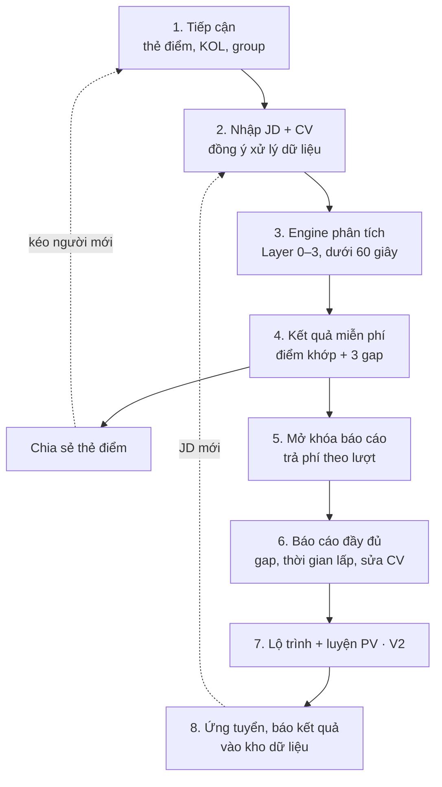
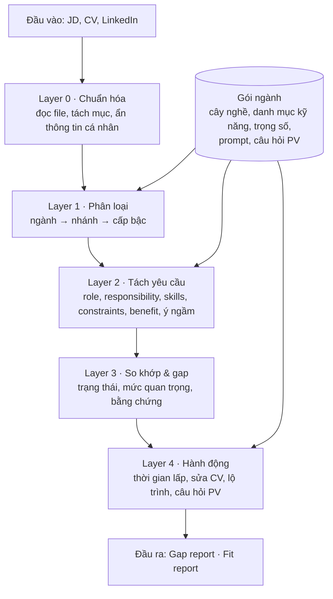

# PRD – Công cụ Fit & Gap tuyển dụng (tên tạm)

Nov 3, 2026 · @Leonard · Bản nháp v0.1 · cập nhật 08/11/2026

## 1. Bối cảnh và vấn đề

Tuyển dụng đang chậm trong khi nhu cầu cần người nhanh tăng lên: không công ty nào muốn mất 1 tháng tuyển một người chỉ làm 2 tháng.

- **Tuyển chậm:** trung vị thời gian tuyển là 39 ngày với vị trí không phải lãnh đạo (SHRM 2026); vị trí kỹ thuật trung bình khoảng 62 ngày. Mỗi lần tuyển cần trung bình 13 buổi phỏng vấn, tăng 42% so với 3 năm trước.
- **Job ngắn hạn tăng:** tin tuyển dạng hợp đồng có trả phí trên LinkedIn tăng 7% so với năm trước, năm thứ ba tăng liên tiếp, dù tổng số tin tuyển giảm.
- **Nhiều người mất việc:** số người bị cho nghỉ trong ngành tech năm 2026 đã vượt cả năm 2025 từ tháng 8 (theo layoffs.fyi).

**Hệ quả:** ứng viên cần biết thật nhanh CV mình thiếu gì, phải cải thiện gì, luyện phỏng vấn gì. Công ty cần biết thật nhanh một ứng viên có hợp vị trí không. Cái tốn thời gian nhất không phải khâu lọc CV mà là các vòng phỏng vấn, nên giá trị lớn nhất nằm ở việc giúp công ty bớt vòng.

## 2. Tầm nhìn và định vị

Sản phẩm là một trợ lý "Fit & Gap" cho cả hai phía của tuyển dụng, chạy trên một engine chung.

- **Ứng viên** biết mình thiếu gì so với JD, mất bao lâu để lấp, và luyện phỏng vấn đúng chỗ yếu.
- **Công ty** biết trong vài phút một ứng viên khớp bao nhiêu, rủi ro ở đâu, nên hỏi gì.

**Câu định vị (đề xuất):** Biết mình thiếu gì, lấp trong 2 tuần, vào việc ngay.

**Lợi thế cần xây:**

1. Dùng ngay trên web, không cần kỹ năng kỹ thuật.
2. Gap có ước tính thời gian lấp và lộ trình, hợp với job ngắn hạn.
3. Phía công ty dùng chung engine, mảng đối thủ mã nguồn mở không làm.
4. Nội dung phỏng vấn từ KOL Việt Nam.
5. Kho dữ liệu kết quả thật (được gọi phỏng vấn, nhận offer) giúp engine chính xác dần.

**Phạm vi ban đầu:** ngành Technical trước, thiết kế để mở rộng sang Sale, Marketing bằng gói ngành.

**Lưu ý tên gọi:** không dùng tên "Career Ops" hay biến thể (xem mục 9).

**Gợi ý tên (chưa chốt):**

| Tên | Ý nghĩa |
| --- | --- |
| Khớp | Đúng việc sản phẩm làm: đo độ khớp người và việc; ngắn, dễ nhớ với người Việt |
| Lấp | Nhấn vào hành động lấp gap; hợp câu định vị "lấp trong 2 tuần" |
| Đúng Việc | Nói thẳng lợi ích cho cả ứng viên lẫn công ty |
| Ghép | Ghép người với việc, gợi hình mảnh ghép vừa khít |
| GapFit | Tên tiếng Anh gộp hai chữ Gap và Fit; dễ dùng nếu sau này ra nước ngoài |
| Vừa Job | Giọng trẻ, đời thường, hợp kênh Facebook/TikTok |

Trước khi chốt cần kiểm tra tên miền, tài khoản mạng xã hội và nhãn hiệu tại Cục Sở hữu trí tuệ.

## 3. Người dùng mục tiêu

Nhóm A và B dùng cùng tính năng nhưng khác mức độ gấp; nhóm C là phía công ty, làm từ V2.

| Nhóm | Tình huống | Điều họ cần | Giai đoạn |
| --- | --- | --- | --- |
| A. Ứng viên vừa mất việc | Cần việc gấp, chấp nhận job ngắn hạn | Biết nên nộp JD nào, sửa CV ra sao để được gọi phỏng vấn | MVP |
| B. Ứng viên muốn lên cấp hoặc sang công ty global/remote | Còn thời gian chuẩn bị, mục tiêu cao | Lộ trình lấp gap, luyện phỏng vấn kiểu Big tech/global | MVP + V2 |
| C. Recruiter / HR / Hiring manager | Cần người nhanh cho dự án vài tháng | Lọc, xếp hạng ứng viên nhanh; biết phỏng vấn nên hỏi gì | V2 |

Thị trường vào đầu tiên: tuyển dụng trong nước (đã chốt 03/11/2026). Đầu vào tiếng Việt là mặc định, tiếng Anh là phụ.

## 4. Phạm vi tính năng theo giai đoạn

MVP chỉ gồm 4 tính năng đầu phía ứng viên; phỏng vấn và phía công ty để V2, khi đã có người dùng và dữ liệu.

| # | Phía | Tính năng | Tiêu chí phải đạt | Giai đoạn |
| --- | --- | --- | --- | --- |
| 1 | Ứng viên | Đọc hiểu JD | Tách đúng role, kỹ năng bắt buộc và cộng điểm, benefit, loại hợp đồng, ý ngầm | MVP |
| 2 | Ứng viên | Chấm độ khớp | Điểm tổng và từng nhóm; mỗi điểm kèm bằng chứng trích từ CV và JD | MVP |
| 3 | Ứng viên | Gap report | Gap xếp theo mức nghiêm trọng, mỗi gap có ước tính thời gian lấp | MVP |
| 4 | Ứng viên | Sửa CV / LinkedIn | Gợi ý viết lại từng dòng, không bịa kinh nghiệm | MVP (bản nhẹ) |
| 5 | Ứng viên | Lộ trình lấp gap | Kế hoạch theo tuần, tài liệu học, cách chứng minh đã học | V2 |
| 6 | Ứng viên | Luyện phỏng vấn | Câu hỏi sinh từ gap của JD, chấm câu trả lời, kịch bản Big tech/global/remote, nội dung KOL | V2 |
| 7 | Ứng viên | Kiểm tra JD còn tuyển, gợi ý JD hợp hơn | Báo JD đã đóng; gợi ý JD có gap nhỏ hơn | V3 |
| 8 | Ứng viên | Theo dõi đơn ứng tuyển | Ghi nộp ở đâu, đến vòng nào, kết quả | V3 |
| 9 | Công ty | Chuẩn hóa JD | Tách bắt buộc / cộng điểm, cảnh báo yêu cầu phi thực tế | V2 |
| 10 | Công ty | Fit report từng ứng viên | % khớp, rủi ro, bằng chứng | V2 |
| 11 | Công ty | Xếp hạng shortlist | Chấm hàng loạt CV cho một JD, sắp xếp, xuất file | V2 |
| 12 | Công ty | Câu hỏi phỏng vấn theo gap | Bộ câu hỏi kiểm tra đúng chỗ yếu của từng người | V2 |
| 13 | Công ty | Tìm ứng viên chủ động | Gợi ý ứng viên trong hệ thống đã đồng ý được liên hệ | V3 |

**Tool đầu tiên để đi marketing** = tính năng 1–4, chỉ ngành Technical, miễn phí 3 gap, có thẻ điểm chia sẻ được và nút nhận báo cáo đầy đủ.

**Bổ sung 03/11/2026 (học từ sản phẩm tham khảo, mục 9):**

| # | Phía | Tính năng | Tiêu chí phải đạt | Giai đoạn |
| --- | --- | --- | --- | --- |
| 14 | Ứng viên | Chấm LinkedIn profile | So profile với JD hoặc nhánh nghề mục tiêu; chỉ ra mục thiếu, headline yếu; cùng quy tắc trích dẫn như CV | MVP miễn phí hoặc V2 |
| 15 | Công ty | Xếp hạng dạng ma trận | Mỗi hàng một ứng viên, mỗi cột một yêu cầu JD, ô = khớp / một phần / thiếu; lọc theo yêu cầu bắt buộc; xuất file | V2 (thay tính năng 11) |

**Cập nhật 04/11/2026 từ blueprint RMO/CareerOps** cho các tính năng đã có:

- **Lộ trình lấp gap (5):** người dùng nhập số giờ rảnh mỗi tuần; vượt quỹ giờ thì nói rõ phải bỏ bớt gì. Học xong khóa không tự tính là đã thạo; cần task thực hành hoặc bài đánh giá lại.
- **Kiểm tra JD còn tuyển (7):** hai trạng thái riêng: tin còn hiển thị, và công ty còn tuyển thật. Không kiểm tra được thì ghi "chưa rõ" và vẫn cho phân tích JD.
- **Câu hỏi phỏng vấn theo gap (6, 12):** chia 4 loại: xác minh, hành vi, tình huống, bài làm thử; mỗi câu kèm điều cần kiểm tra và thang chấm.
- **Xếp hạng dạng ma trận (15):** HR chốt tiêu chí chấm trước rồi mới so CV. Bộ lọc cứng chỉ cho điều kiện rõ ràng, được bỏ qua kèm lý do. CV không ghi số năm kinh nghiệm không tự thành "không đủ năm". Đổi tiêu chí thì các so sánh cũ bị đánh dấu là cũ.
- **Ý cho V3 phía công ty:** lập lịch tuyển ngược từ ngày cần người làm được việc, hợp với luận điểm job ngắn hạn cần tuyển nhanh.

## 5. Luồng hành động

Cả hai phía dùng chung một engine và cùng đổ kết quả tuyển dụng thật về một kho dữ liệu; luồng ứng viên làm trước.



Ba vòng lặp giữ sản phẩm chạy: chia sẻ thẻ điểm kéo người mới (lan truyền), mỗi JD mới là một lượt dùng mới (quay lại), và kết quả thật làm engine chính xác dần (dữ liệu). Thiếu bước 8 thì vòng dữ liệu không chạy.

**Luồng công ty (V2)**, dùng lại đúng engine trên:

1. Đăng JD, engine chuẩn hóa yêu cầu.
2. Nhận CV: tải lên hoặc từ kho ứng viên đã đồng ý được liên hệ.
3. Fit report: chấm và xếp hạng CV.
4. Phỏng vấn với bộ câu hỏi đúng chỗ yếu của từng người.
5. Quyết định tuyển với ít vòng phỏng vấn hơn.
6. Báo kết quả vào kho dữ liệu chung.

**Luồng ứng tuyển hộ (ứng viên + recruiter)**, đã chốt 03/11/2026: đội mình chủ động nhắn tin cho ứng viên, lấy CV, rồi nộp vào các JD phù hợp.

0. Ký thỏa thuận phí với công ty trước khi nộp; JD cào về dùng để chọn công ty đi chào (bổ sung 08/11/2026, [chien-luoc.md](chien-luoc.md) mục 1).
1. Tìm ứng viên tiềm năng (ưu tiên người đang tìm việc, đã dùng tool miễn phí). Không cào profile: engine soạn chuỗi tìm kiếm, người của mình xem và nhắn từng người, cộng nguồn ứng viên tự tìm tới qua JD đăng ở cộng đồng (chốt 08/11/2026, [ho-so-ung-vien.md](ho-so-ung-vien.md) mục 5.1).
2. Nhắn tin mời kèm link có token; ứng viên đồng ý, gửi CV và xác minh là chủ CV ([ho-so-ung-vien.md](ho-so-ung-vien.md) mục 3.3).
3. Engine chấm CV với kho JD đang mở, chọn các JD khớp nhất.
4. Gửi danh sách JD cho ứng viên duyệt; chỉ nộp khi ứng viên đồng ý từng JD.
5. Sửa CV theo từng JD rồi nộp, kèm fit report cho nhà tuyển dụng.
6. Theo dõi đến khi có kết quả, ghi vào kho dữ liệu.

Đây thực chất là dịch vụ giới thiệu việc làm, nên cần lưu ý pháp lý ở mục 12. Theo thông lệ ngành, headhunter hợp pháp không thu phí ứng viên; phí do doanh nghiệp tuyển dụng trả.

## 6. Kiến trúc engine

Engine tách thành phần lõi dùng chung và gói ngành: thêm Sale hay Marketing là thêm một gói, không sửa code lõi.



Gói ngành cấp kiến thức cho Layer 1, 2 và 4; Layer 0 và 3 thuần lõi. Danh mục kỹ năng dựng từ ESCO và O\*NET rồi tinh chỉnh.

**Layer 1** phân loại theo cây (Technical → Backend / Frontend / Data / DevOps → cấp bậc). Một JD có thể thuộc nhiều nhánh. Ngành của CV lệch ngành của JD là gap lớn nhất, báo ngay từ đầu.

**Layer 2** dùng các ô chung: Role, Hard skills (đổi tên từ ô "Technical" trong bản nháp để dùng được cho mọi ngành), Soft skills, Constraints, Benefit (gồm loại và thời hạn hợp đồng), Other intent. Mỗi yêu cầu lưu theo khuôn:

```json
{
  "slot": "hard_skill",
  "name": "Kubernetes",
  "canonical_id": "tech.devops.k8s",
  "level": "intermediate",
  "importance": "critical",
  "evidence_tier": "stated",
  "jd_signal": "3+ years running K8s in production",
  "domain": "technical"
}
```

**Quy tắc chấm cho Layer 2–3** (học từ career-ops):

- Đọc JD trước, chấm mức quan trọng chỉ từ JD; sau đó mới đọc CV để so.
- 5 mức quan trọng cố định: critical, high, meaningful, preferred, low\_signal.
- 3 mức bằng chứng: stated (JD ghi rõ), structural (suy từ cấu trúc JD), inferred (AI tự suy luận). Yêu cầu inferred không bao giờ được xếp critical hoặc high.
- Kết luận "khớp" phải trích nguyên văn dòng CV.
- `canonical_id` gom các cách viết khác nhau về một kỹ năng ("K8s", "Kubernetes", "EKS").

**Quy tắc cứng cho Layer 4 (sửa CV, LinkedIn)**, bổ sung 03/11/2026 sau khi xem review Enhancv:

- Chỉ gợi ý; người dùng tự bấm chép hoặc áp dụng từng dòng. Không tự viết đè cả CV.
- Giữ giọng văn của người dùng: sửa ít nhất có thể, không biến thành văn mẫu chung chung.
- Không thêm kinh nghiệm, công ty, công nghệ không có trong CV gốc; số liệu chưa có thì để ô \[số\].
- Không đổi ngày tháng, chức danh, tên công ty, con số đã có.
- Code kiểm tra sau AI: so ngày tháng, con số, tên riêng và công nghệ giữa câu gốc và câu gợi ý; có cái mới xuất hiện hoặc bị đổi thì loại gợi ý đó.

**Trạng thái bằng chứng và loại gap** (cập nhật 04/11/2026 từ blueprint RMO/CareerOps): không thấy trong CV khác với thiếu kỹ năng. Layer 3 không được ghi "Thiếu" khi chỉ là CV không nhắc tới.

| Trạng thái | Khi nào | Việc nên làm tiếp |
| --- | --- | --- |
| Khớp | Có câu kinh nghiệm hoặc dự án cụ thể, trích nguyên văn | — |
| Chỉ liệt kê | Kỹ năng chỉ nằm trong mục Kỹ năng, không có kinh nghiệm đi kèm | Bổ sung ví dụ cụ thể vào CV |
| Một phần | Có kinh nghiệm liên quan nhưng chưa đủ mức JD yêu cầu | Viết lại cho rõ hoặc luyện thêm |
| Chưa thấy trong CV | Không có thông tin để kết luận | Hỏi ứng viên: có → thêm bằng chứng; không → đưa vào lộ trình học |
| Thiếu (đã xác nhận) | Ứng viên xác nhận chưa có, hoặc bài đánh giá không đạt | Học |
| Không áp dụng | Yêu cầu không nói về ứng viên (vd. hình thức làm việc) | — |

- **Loại gap:** thiếu năng lực / thiếu bằng chứng / thiếu trách nhiệm hoặc domain. Mỗi gap kèm loại việc tiếp theo: thêm bằng chứng, làm bài đánh giá, luyện task, học kiến thức nền, hoặc chấp nhận chưa phù hợp.
- **Quyền sửa kết luận:** người dùng xác nhận hoặc sửa từng trạng thái; mỗi lần sửa được lưu làm nhãn dữ liệu cho kho kết quả.
- **Tính điểm:** "Chưa thấy trong CV" không tính như "Thiếu". Khi còn mục chưa thấy, điểm hiện thành khoảng (vd. 37–97%): đầu thấp coi như chưa có, đầu cao coi như có; người dùng xác nhận từng mục thì khoảng hẹp lại. Đã làm trong bản demo engine. Điểm không trình bày như xác suất đậu phỏng vấn.
- **Layer 2 thêm ô "responsibility":** tách yêu cầu về kỹ năng với yêu cầu về trách nhiệm công việc. Một từ khóa có trong CV chưa chứng minh đã làm đúng trách nhiệm ở đúng cấp độ.
- **Phiên bản:** lưu phiên bản JD và CV (Layer 0 sinh mã phiên bản từ nội dung). CV hoặc JD đổi thì các kết luận cũ dựa trên nó bị đánh dấu là cũ.
- **Sửa CV:** chọn thành tích có thật trong CV trước rồi mới gợi ý câu; hiện so sánh trước/sau; người dùng chấp nhận hoặc bỏ từng gợi ý.

**Yêu cầu engine phải đạt** (bổ sung 06/11/2026, đối chiếu code bản demo engine): nhận một cặp JD–CV, trả danh sách yêu cầu kèm trạng thái, trích dẫn và thời gian lấp trong dưới 60 giây; đúng tới mức recruiter đồng ý và chạy lại vẫn ra như cũ. Bản chi tiết và các câu hỏi cần bàn ở [engine.md](engine.md).

Khi phải đánh đổi, ưu tiên theo thứ tự: không báo sai gap ở yêu cầu bắt buộc → bằng chứng là câu thật → nhất quán → đầy đủ → nhanh. Phía ứng viên, lỗi đắt nhất là báo nhầm "thiếu" ở yêu cầu bắt buộc, vì người dùng sẽ bỏ một JD đáng nộp. Phía công ty (V2), lỗi đắt nhất là báo khớp sai.

| Layer | Phải đạt | Bản demo hiện tại |
| --- | --- | --- |
| 0 | Đọc PDF/DOCX, kể cả CV 2 cột xuất từ TopCV/Canva | Chỉ nhận văn bản dán vào |
| 0 | Ẩn thông tin cá nhân, 0 rò rỉ trên bộ test; bỏ cả ngày sinh, giới tính, hôn nhân, quê quán, ảnh, tên trường (mục 7) | Ẩn email, SĐT, link, tên ở dòng đầu; chưa bỏ các trường còn lại |
| 0 | Tách mục Kinh nghiệm, Dự án, Kỹ năng, Học vấn; code tính số năm kinh nghiệm từ các mốc thời gian | Chỉ tách mục Kỹ năng; chưa tính số năm |
| 1 | Xếp JD và CV vào cây nghề cố định; đúng nhánh ≥ 90%, cấp bậc lệch tối đa 1 bậc; lệch nhánh thì cảnh báo ngay | AI tự phân loại, chỉ hiện một dòng chữ |
| 2 | Không sót yêu cầu bắt buộc | Giới hạn 14 yêu cầu |
| 2 | `canonical_id` lấy từ danh mục đóng khoảng 200 kỹ năng kèm tên gọi khác | AI tự đặt id, mỗi lần chạy có thể khác |
| 2 | Tách điều kiện có số (vd. "3 năm, trong đó 2 năm Golang") thành dữ liệu để code so | Chưa có trường mức độ, số năm |
| 3 | Câu trích là nguyên dòng CV, hoặc đủ dài và có tên kỹ năng | Code kiểm câu trích có trong CV, nhưng trích "Go" vẫn qua; AI diễn đạt lại câu thì bị hạ oan thành "Chưa thấy trong CV" |
| 3 | Xử lý câu phủ định, việc của team so với việc cá nhân, kinh nghiệm đã cũ (lưu năm dùng gần nhất) | Chỉ dựa vào AI |
| 3 | Code so số năm kinh nghiệm với yêu cầu | Chưa có |
| 4 | Code loại gợi ý sửa CV có ngày tháng, con số, tên riêng, công nghệ mới (quy tắc ở trên) | Chưa có; gợi ý đi thẳng từ AI ra màn hình |
| Chung | Lưu kết quả theo mã JD, mã CV và phiên bản engine; cố định phiên bản model; ghi nhật ký model và prompt (Luật Trí tuệ nhân tạo) | Có mã phiên bản; chưa lưu kết quả, chưa cố định model |
| Chung | Chống câu lệnh cài trong CV hoặc JD; chạy được JD tiếng Anh với CV tiếng Việt; đo chi phí mỗi lượt | Mới dặn trong prompt; chưa thử, chưa đo |

Danh mục kỹ năng là nền của cả engine: thiếu nó thì không nhất quán được, không gom được dữ liệu kết quả và không tra được thời gian lấp.

**Thời gian lấp gap:** bản demo để AI tự chọn 1 trong 5 khoảng, không dựa vào dữ liệu. Đây là lời hứa trong câu định vị, nên cần:

- Bảng thời gian lấp theo bộ ba: kỹ năng cần có, kỹ năng liền kề đã có, mức cần đạt. Người có kinh nghiệm lập bảng; AI chỉ được chọn trong bảng.
- Tách theo loại gap: thiếu bằng chứng thì sửa CV là xong ngay; thiếu năng lực thì tra bảng; thiếu trách nhiệm hoặc domain (vd. vận hành K8s ở production) thường không lấp được bằng học 2 tuần, và engine phải nói rõ điều đó.

## 7. Tiêu chí chất lượng

Người dùng chỉ tin tool khi kết quả đúng, có bằng chứng và chạy lại vẫn ra như cũ.

| Tiêu chí | Yêu cầu cụ thể |
| --- | --- |
| Chính xác | Báo gap sai ở yêu cầu bắt buộc ≤ 5%; các chỉ số khác theo bộ chỉ số engine ở mục 11 |
| Giải thích được | Mọi kết luận trích nguyên văn dòng CV hoặc JD làm bằng chứng |
| Nhất quán | Cùng một cặp JD–CV chạy lại ra điểm gần như nhau; dùng mức cố định thay vì điểm 0–100 |
| Nhanh | Gap report trong dưới 60 giây |
| Công bằng | Không chấm theo tuổi, giới tính, ảnh, trường học; bỏ các thông tin này trước khi chấm |
| Bảo mật | Xin đồng ý trước khi lưu CV, cho xóa dữ liệu, tuân thủ quy định bảo vệ dữ liệu cá nhân của Việt Nam |
| Song ngữ | Nhận CV/JD tiếng Việt hoặc tiếng Anh; báo cáo theo ngôn ngữ người dùng chọn |
| Đầu vào linh hoạt | PDF, DOCX, văn bản dán vào, link JD |
| Dễ mở rộng ngành | Thêm ngành bằng gói ngành, không sửa code lõi |

## 8. Mô hình kinh doanh và marketing

Thu tiền theo lượt ở phía ứng viên trước, B2B ở phía công ty sau, vì người đang tìm việc dễ trả cho từng JD hơn là trả theo tháng.

**Phễu thu tiền:** quét gap miễn phí → trả phí báo cáo đầy đủ + sửa CV → trả phí lộ trình và luyện phỏng vấn theo từng JD.

**Nguồn doanh thu:**

- Thu theo lượt (từng JD, từng buổi luyện phỏng vấn). Giá thử nghiệm đề xuất: 99.000đ cho một lần chấm kèm buổi luyện.
- Chia doanh thu với KOL: họ mang người dùng và nội dung phỏng vấn, mình cung cấp công cụ. Leader phụ trách tìm KOL.
- B2B cho recruiter và công ty (V2): giá cao hơn, bán chậm hơn; tùy chọn "CV không rời khỏi hệ thống" để thu giá cao hơn.

**Tool phải tự kéo người dùng:**

1. Có giá trị trong 1 phút, miễn phí: điểm khớp + 3 gap lớn nhất.
2. Kết quả chia sẻ được: thẻ điểm kiểu "CV của mình khớp 72% với JD Backend Senior" để đăng Facebook, LinkedIn.
3. Có chỗ thu tiền: muốn xem đầy đủ thì trả phí hoặc để lại email.
4. Đo được kết quả thật: tỷ lệ được gọi phỏng vấn sau khi sửa CV, vừa đo chất lượng vừa là nội dung quảng cáo.

**Kênh ban đầu:** thẻ điểm được chia sẻ, KOL hướng dẫn phỏng vấn, các group IT và việc làm trên Facebook.

**Giả thuyết giá (thị trường trong nước, cần kiểm chứng):**

| Gói | Ai trả | Nội dung | Giá thử nghiệm |
| --- | --- | --- | --- |
| Miễn phí | — | Điểm khớp + 3 gap lớn nhất, thẻ chia sẻ | 0đ |
| Một JD | Ứng viên | Báo cáo đầy đủ + gợi ý sửa CV cho 1 JD | 49.000đ |
| Gói tìm việc | Ứng viên | 5 JD + 1 buổi luyện phỏng vấn (V2) | 199.000đ |
| Ứng tuyển hộ | Doanh nghiệp | Ứng viên đã chấm và sửa CV, kèm fit report; chỉ nộp khi đã ký thỏa thuận phí | Phí khi tuyển thành công, không cam kết số lượng; mức % cần khảo sát |
| Gói recruiter (V2) | Doanh nghiệp | Chấm và xếp hạng CV hàng loạt theo JD | Theo tháng; chốt sau khi thử với 2–3 recruiter |

Cách thử: tuần 1 đưa 2 mức giá cho hai nhóm người dùng khác nhau, đo tỷ lệ chuyển khoản thật. Luồng ứng tuyển hộ không thu phí ứng viên.

Chính sách đề xuất (đang hiện trên màn thanh toán, cần leader duyệt): hoàn tiền trong 7 ngày nếu báo cáo sai. Thanh toán qua chuyển khoản QR, ví điện tử hoặc thẻ.

**Bổ sung 03/11/2026 từ sản phẩm tham khảo:**

- **Hoàn tiền:** Resume Worded thường không hoàn tiền sau khi người dùng đã dùng tính năng AI vì chi phí chạy cao, và điều này gây review 1 sao. Trước khi chốt hoàn tiền 7 ngày, tính chi phí API mỗi lượt.
- **Không tự gia hạn:** gia hạn tự động gây bất ngờ khó chịu xuất hiện trong nhiều review của Resume Worded. Mình thu theo lượt nên dùng được làm điểm bán hàng.
- **Kênh newsletter / mẹo tìm việc:** trong khoảng 25 review gần nhất của Resume Worded, khoảng 10 review chủ yếu khen newsletter. Chạy một bản tin hoặc page mẹo tìm việc song song với tool để tạo niềm tin.
- **Hỗ trợ nhanh:** khiếu nại nhiều nhất của Enhancv là hỗ trợ chậm, chỉ qua email. Mình dùng kênh trả lời nhanh như Zalo.
- **Mốc giá B2B tham khảo:** gói Professional của AG5 là €699/tháng (giá châu Âu, chỉ để biết khung).

**Bổ sung 08/11/2026: engine chạy như một headhunter** ([chien-luoc.md](chien-luoc.md)). Công ty chưa ký thì không có nghĩa vụ trả phí, nên phải ký thỏa thuận trước khi nộp CV. Ba giai đoạn:

- **Giai đoạn 0, chưa có giấy phép:** tool miễn phí làm đầy kho, ứng viên tự nộp, chọn 1–2 nhánh hẹp theo cung và cầu.
- **Giai đoạn 1, có giấy phép hoặc đối tác:** chào công ty bằng hồ sơ ẩn danh, thu phí khi tuyển thành công.
- **Giai đoạn 2:** hợp đồng trọn gói với từng công ty đã tuyển thành công qua mình.

Chưa có công ty nào sẵn sàng ký phí, nên bắt đầu từ giai đoạn 0.

## 9. Đối thủ và tham khảo career-ops

[career-ops](https://github.com/career-ops-hq/career-ops) là nguồn tham khảo tốt nhất cho Layer 2–3, nhưng không dùng nguyên làm engine và không được dùng tên của nó.

**career-ops là gì:** AI agent tìm việc mã nguồn mở (MIT), hơn 700 người đóng góp, chạy trên máy từng người qua AI coding CLI, lõi là các file prompt Markdown. Đã có bộ prompt tiếng Việt và đang chuẩn bị bản web.

| Ý tưởng của mình | career-ops |
| --- | --- |
| Quét JD + CV, so khớp | Có, làm kỹ (Block B) |
| Gap kèm cách khắc phục | Có |
| Phân loại ngành nghề | Một phần, chỉ 6 loại vai trò AI |
| Kiểm tra JD còn tuyển | Có |
| Lộ trình lấp gap | Một phần, chưa có ước tính thời gian |
| Luyện phỏng vấn | Có |
| Đo độ chính xác engine | Có (bộ mẫu đã gán nhãn) |
| Phía công ty | Không có |
| KOL, ước tính thời gian lấp gap | Không có |

**Nên lấy:**

- Quy tắc chấm của Block B: đọc JD trước rồi mới đọc CV; 5 mức quan trọng cố định; 3 mức bằng chứng (JD ghi rõ / suy từ cấu trúc / AI tự suy luận), yêu cầu do AI tự suy luận không bao giờ xếp mức cao nhất; mỗi kết luận "khớp" phải trích nguyên văn CV.
- Module không cần AI, dùng lại được theo MIT (giữ thông báo bản quyền): trích kỹ năng, phân gap, kiểm tra JD còn mở.
- Cách đo độ chính xác bằng bộ mẫu đã gán nhãn; bộ prompt tiếng Việt đọc JD theo thông lệ Việt Nam.

**Không lấy nguyên làm engine:** kiến trúc một người một máy, dữ liệu là file; repo rất lớn và đổi hằng ngày; phân loại nghề thiên về AI.

**Tên gọi:** theo [TRADEMARK.md](https://github.com/career-ops-hq/career-ops/blob/main/TRADEMARK.md), không được dùng "career-ops" hoặc biến thể trong tên sản phẩm, tên miền, tài khoản thương mại, kể cả "Powered by career-ops". Được ghi "dựa trên career-ops".

**Đối thủ khác:** công cụ chấm CV kiểu ATS (Jobscan, Teal) chủ yếu so keyword; công cụ luyện phỏng vấn AI hỏi chung chung. Mô tả này chưa kiểm tra lại tính năng mới nhất của từng công cụ.

**Đối thủ trong nước cần theo dõi:** ứng dụng TopCV đã có tính năng đánh giá mức độ phù hợp và cạnh tranh với công việc ứng tuyển bằng AI ([App Store](https://apps.apple.com/app/id1455928592)). Khác biệt của mình phải nằm ở gap kèm thời gian lấp, bằng chứng trích dẫn, luyện phỏng vấn theo gap và luồng ứng tuyển hộ.

**Bài học từ 5 sản phẩm tham khảo** (xem 03/11/2026):

| Sản phẩm | Đánh giá | Phân khúc | Nên lấy | Áp vào |
| --- | --- | --- | --- | --- |
| [365Talents](https://www.g2.com/products/365talents/reviews) | G2 4,8/5 · 112 review | B2B, nội bộ doanh nghiệp | Tự suy ra kỹ năng từ chức danh và kinh nghiệm; nhấn mạnh giảm thiên kiến. Tránh: triển khai trung bình 5 tháng | Layer 2–3: kỹ năng liền kề để ước tính thời gian lấp gap |
| [AG5](https://www.g2.com/products/ag5-skills-management-software/reviews) | G2 4,6/5 · 66 review | B2B, ma trận kỹ năng | Ma trận người × kỹ năng, nhìn gap ngay. Bị chê: cài đặt tốn thời gian, thiếu dashboard | Màn xếp hạng CV dạng ma trận (tính năng 15) |
| [Visier](https://www.g2.com/products/visier/reviews) | G2 4,6/5 · 223 review | B2B, phân tích nhân sự | Báo cáo dữ liệu thị trường; triển khai khoảng 6 tháng nên chưa liên quan | Về sau: báo cáo kỹ năng đang được tuyển nhiều từ kho JD |
| [Enhancv](https://www.trustpilot.com/review/enhancv.com) | Trustpilot 4,6/5 · 1.007 review | B2C, tạo và sửa CV | UX dễ dùng, sửa CV theo từng JD. Bị chê: AI viết lại chung chung, tự đổi ngày tháng, hỗ trợ chậm | Quy tắc cứng Layer 4 (mục 6) |
| [Resume Worded](https://www.trustpilot.com/review/resumeworded.com) | Trustpilot 4,8/5 · 3.008 review | B2C, chấm CV và LinkedIn | Phễu chấm miễn phí → Pro; chấm LinkedIn; newsletter tạo niềm tin. Bị chê: góp ý chung chung, không hoàn tiền sau khi dùng AI, tự gia hạn | Tính năng 14; mục 8 |

Traffic tìm kiếm của các sản phẩm này chưa kiểm chứng nguồn.

**Tài liệu tham khảo nội bộ:** blueprint "RMO / CareerOps – Từ khoảng trống JD/CV tới người sẵn sàng cho công việc" (03/11/2026), 16 mô-đun, 28 nguồn. Đã lấy: trạng thái bằng chứng (mục 6), loại gap, phiên bản, rubric và interview kit (mục 4), bộ đánh giá (mục 11). Chưa lấy: các mô-đun workforce planning, ngân sách quảng cáo, onboarding. Tài liệu tự ghi chưa chạy thử sản phẩm nào; phần Reddit chỉ để gợi ý giả thuyết. Cần làm rõ quan hệ với nền RMO hiện có (mục 12).

## 10. Chiến lược model: local và cloud

Kết hợp: model tự host trên server của mình cho các bước đơn giản, chạy nhiều và cần bảo vệ dữ liệu; model cloud cho phần người dùng đọc trực tiếp và trả tiền. "Local" ở đây là tự host trên server, không phải chạy trên máy người dùng.

| Layer | Dùng local? |
| --- | --- |
| 0. Chuẩn hóa, xóa thông tin cá nhân | Rất hợp; phần lớn không cần AI |
| 1. Phân loại ngành | Rất hợp; model nhỏ hoặc embedding + bộ phân loại |
| 2. Tách yêu cầu ra JSON | Được với model cỡ trung + ép đầu ra theo JSON schema; "ý ngầm" cần kiểm tra kỹ |
| 3. So khớp & gap | Một phần; embedding local, ca khó đẩy lên model lớn |
| 4. Viết đầu ra (sửa CV, lộ trình, phỏng vấn) | Giai đoạn đầu dùng cloud |

**Model ứng viên:** Qwen 3.6 (bản 27B chạy trên một GPU 24GB; bản MoE 35B-A3B; giấy phép Apache-2.0), Gemma 4, các model embedding mã nguồn mở. Chất lượng tiếng Việt phải tự đo trên dữ liệu CV/JD của mình.

**Lộ trình:**

1. Thử nghiệm: dùng cloud cho cả engine, nhưng mọi lời gọi model đi qua một giao diện chung kiểu OpenAI để đổi model chỉ bằng cấu hình.
2. Chạy song song local và cloud cho từng layer trên bộ 50 cặp JD–CV đã gán nhãn; layer nào local khớp ≥ 90% so với cloud thì chuyển sang local.
3. Bản miễn phí chạy chủ yếu bằng local; bản trả phí dùng cloud cho Layer 4.
4. Khi bán B2B: tùy chọn chạy toàn bộ bằng local.

**Công cụ:** Ollama để thử trên máy dev; vLLM cho production (có ép đầu ra theo JSON schema).

## 11. Kế hoạch thử nghiệm (4 tuần)

Trong 4 tuần cần trả lời ba câu: engine có chấm đúng không, ứng viên có trả tiền không, công ty có muốn dùng không.

| Giả thuyết | Coi là đạt khi |
| --- | --- |
| H1. Engine xác định gap gần đúng như recruiter giỏi | Đạt bộ chỉ số engine bên dưới; chỉ số chính là báo gap sai ở yêu cầu bắt buộc ≤ 5% |
| H2. Ứng viên thấy gap report hữu ích và chịu trả tiền | ≥ 30% người thử chuyển khoản thật cho lần tiếp theo |
| H3. Recruiter thấy fit report giúp lọc nhanh hơn | 2/3 recruiter muốn dùng tiếp trên ứng viên thật |

**Các bước:**

1. **Tuần 1 – chạy thủ công:** thu 20–30 cặp JD–CV thật; dùng bộ prompt theo các layer, bắt AI trả JSON theo khuôn; gửi gap report và hỏi 3 câu (đúng không, sẽ làm gì tiếp, có trả 99.000đ không). Kiểm chứng H2.
2. **Tuần 2–3 – prototype engine:** ngành Technical, 4 nhánh (Backend, Frontend, Data, DevOps), khoảng 200 kỹ năng; pipeline Layer 0–3; Python + API model qua JSON schema; giao diện Streamlit hoặc Google Form + email. Nhờ 1–2 recruiter chấm tay 50 cặp, so với engine, chỉnh và chạy lại 2–3 vòng. Kiểm chứng H1.
3. **Tuần 3–4 – thử phía công ty:** 2–3 recruiter quen chạy fit report trên ứng viên thật. Kiểm chứng H3.
4. **Cuối tuần 4 – quyết định.**

| Kết quả | Quyết định |
| --- | --- |
| Đạt H1 và H2 | Làm MVP thật, thêm luyện phỏng vấn, tìm KOL |
| Đạt H1, không đạt H2 | Cân nhắc chuyển sang B2B |
| Không đạt H1 | Sửa engine trước, chưa đi bán |

**Bộ đánh giá engine** (bổ sung 04/11/2026): hai người gán nhãn độc lập. Bộ test phải có các ca khó: CV chỉ liệt kê kỹ năng, tên gọi khác của cùng kỹ năng, việc làm theo team, dữ liệu cũ, và ca phủ định. Đo riêng: độ đúng khi tách yêu cầu, độ đúng của bằng chứng và trạng thái, **tỷ lệ báo gap sai**, số lần người dùng sửa kết luận. Không đổi các chỉ số này thành xác suất trúng tuyển.

**Bộ chỉ số engine** (đề xuất 06/11/2026, cần chốt ngưỡng): thay cho "khớp ≥ 80% với recruiter", vì con số đó chưa nói khớp ở mức nào. Nếu hai người gán nhãn chỉ đồng ý với nhau 70% thì engine không thể đạt 80%.

| Chỉ số | Ngưỡng đề xuất |
| --- | --- |
| Báo gap sai ở yêu cầu bắt buộc (chỉ số chính) | ≤ 5% |
| Không sót yêu cầu bắt buộc khi tách JD | ≥ 95% |
| Xếp đúng mức quan trọng (bắt buộc, quan trọng so với phần còn lại) | ≥ 85% |
| Trạng thái đúng so với nhãn | ≥ mức hai người gán nhãn đồng ý với nhau, trừ 5 điểm |
| Câu trích hợp lệ | 100% (code bắt buộc) |
| Chạy lại không dùng kết quả đã lưu, trạng thái giống nhau | ≥ 95%; riêng yêu cầu bắt buộc 100% |
| Thời gian lấp cùng khoảng hoặc lệch 1 khoảng so với senior | ≥ 70% |
| Rò rỉ thông tin cá nhân trên bộ test | 0 |
| Thời gian chạy (p95) | < 60 giây |

Bộ 50 cặp nên phủ đủ 4 nhánh × 3 cấp bậc, có cả JD/CV tiếng Anh và trộn ngôn ngữ. Ngoài các ca khó ở trên, thêm: lệch nhánh, CV PDF 2 cột, JD viết chung chung, CV có câu lệnh cài vào.

**Thứ tự làm engine:**

1. Danh mục kỹ năng kèm tên gọi khác: nền của Layer 2, Layer 3, thời gian lấp và kho dữ liệu.
2. 50 cặp đã gán nhãn và script đo: chưa có thì không biết engine tốt hay xấu.
3. Vá các lỗ của bản demo (bảng ở mục 6): kiểm tra khi sửa CV, độ dài tối thiểu của câu trích, tính năm kinh nghiệm bằng code, ẩn thêm thông tin cá nhân, lưu kết quả theo phiên bản.
4. Bảng thời gian lấp gap.
5. Đọc PDF/DOCX.

Tuần 1 chạy thủ công chưa cần bước 3–5; bước 1–2 nên bắt đầu ngay vì tuần 2–3 sẽ cần.

**Phân công đề xuất:** Đạt làm prompt, khuôn dữ liệu, prototype và bộ đo độ chính xác; Thanh tìm ứng viên và recruiter, phỏng vấn người dùng, thử thu tiền.

**Chỉ số theo dõi sau khi ra mắt:** tỷ lệ người vào có nhận được kết quả miễn phí, tỷ lệ chia sẻ thẻ điểm, tỷ lệ trả phí, đánh giá độ chính xác của người dùng, tỷ lệ được gọi phỏng vấn sau khi sửa CV.

## 12. Rủi ro và câu hỏi mở

**Rủi ro:**

| Rủi ro | Cách xử lý |
| --- | --- |
| Tự động quét LinkedIn, kiểm tra Open To Work rồi nhắn tin vi phạm điều khoản LinkedIn, tài khoản có thể bị khóa | Không đặt sản phẩm lõi lên luồng này; JD copy tay hoặc từ nguồn công khai |
| CV chứa thông tin cá nhân | Xin đồng ý, xóa tên và số điện thoại trước khi đưa vào AI, cho người dùng xóa dữ liệu |
| Đối thủ mã nguồn mở miễn phí, đã có tiếng Việt, đang làm bản web | Tập trung lợi thế mục 2: web cho người không rành kỹ thuật, phía công ty, thời gian lấp gap, KOL, kho dữ liệu |
| Sản phẩm hai phía khó khởi động: không có ứng viên thì công ty không dùng và ngược lại | Làm phía ứng viên trước, dùng kho ứng viên đã đồng ý để bán cho công ty |
| AI tự bịa gap hoặc chấm không nhất quán | Quy tắc 3 mức bằng chứng, mức quan trọng cố định, cố định phiên bản model, bộ mẫu đã gán nhãn |
| Không có dữ liệu kết quả thật nếu ứng viên không báo lại | Email nhắc sau 2 tuần hỏi "bạn có được gọi phỏng vấn không?" |
| Nộp CV vào JD công khai khi chưa ký với công ty thì không thu được phí; tranh chấp khi ứng viên đã tự nộp hoặc agency khác đã nộp | Ký thỏa thuận phí trước khi nộp; ghi nhật ký nộp; hợp đồng có thời hạn sở hữu ứng viên ([chien-luoc.md](chien-luoc.md)) |

**Rủi ro pháp lý của luồng ứng tuyển hộ:** doanh nghiệp làm dịch vụ việc làm phải có giấy phép do cơ quan quản lý việc làm cấp tỉnh cấp ([Thư viện Pháp luật](https://thuvienphapluat.vn/phap-luat/cong-ty-gioi-thieu-viec-lam-de-duoc-cap-giay-phep-hoat-dong-dich-vu-viec-lam-can-nhung-dieu-kien-gi-954456-124923.html)) và ký quỹ 300 triệu đồng theo Nghị định 23/2021/NĐ-CP ([LuatVietnam](https://luatvietnam.vn/hanh-chinh/giay-phep-dich-vu-viec-lam-570-95385-article.html)). Bộ Nội vụ đang soạn nghị định mới theo Luật Việc làm 2025 ([dự thảo](https://moha.gov.vn/KND/vb/vbdt/Lists/VBDT/Attachments/864/48202510199Bang%20so%20sanh,%20thuyet%20minh.pdf)), nên điều kiện có thể thay đổi. Cần hỏi luật sư trước khi chạy luồng này: làm qua đối tác đã có giấy phép, hay tự xin giấy phép.

**Câu hỏi mở cần chốt với leader:**

- [x] Thị trường đầu tiên: tuyển dụng trong nước.
- [x] Luồng Open To Work → inbox: dành cho cả ứng viên và recruiter; mình nhắn tin ứng viên, lấy CV, nộp vào JD phù hợp (mục 5).
- [ ] Tên sản phẩm: chọn từ danh sách gợi ý ở mục 2, kiểm tra tên miền và nhãn hiệu.
- [ ] Layout các màn hình MVP: bản nháp đầu tiên ở [Layout MVP – Khớp](https://claude.ai/artifact/1HpuHXNHSYjtYpbyhjG38Y), cần leader duyệt.
- [ ] Mức giá: thử theo bảng giả thuyết ở mục 8.
- [ ] KOL phỏng vấn: leader phụ trách.
- [ ] Pháp lý luồng ứng tuyển hộ: hỏi luật sư, chọn đi qua đối tác có giấy phép hay tự xin giấy phép.
- [ ] Khảo sát mức phí headhunt IT trong nước để định giá luồng ứng tuyển hộ.
- [ ] Chọn nhánh hẹp đầu tiên cho luồng ứng tuyển hộ ([chien-luoc.md](chien-luoc.md) mục 4).
- [x] Không cào CV hay profile ứng viên; tìm người để nhắn bằng tay (chốt 08/11/2026, [ho-so-ung-vien.md](ho-so-ung-vien.md) mục 5.1).

* [ ] Làm rõ quan hệ với nền RMO hiện có (blueprint RMO/CareerOps 03/11/2026): engine Fit & Gap xây mới hay dùng lại các khối của RMO? Ảnh hưởng tới mục 6, 10 và prompt Layer 0.
* [ ] Chốt ngưỡng bộ chỉ số engine (mục 11) và chọn người lập bảng thời gian lấp gap (mục 6).

## 13. Layout MVP

Bản nháp layout đầu tiên có 5 màn hình, xem và sửa trực tiếp tại [Layout MVP – Khớp (tên tạm)](https://claude.ai/artifact/1HpuHXNHSYjtYpbyhjG38Y). Thiết kế cho điện thoại trước vì người dùng chủ yếu đến từ Facebook; riêng bảng điều phối dùng giao diện máy tính. Màn 1 và 2 bấm thử được để đi sang các màn sau.

| # | Màn hình | Người dùng | Nội dung chính | Bước trong luồng (mục 5) | Giai đoạn |
| --- | --- | --- | --- | --- | --- |
| 1 | Nhập JD + CV | Ứng viên | Ô dán JD hoặc link, tải CV (PDF/DOCX), đồng ý xử lý dữ liệu, nút "Phân tích miễn phí" | 2 | MVP |
| 6 | Đang phân tích | Ứng viên | 5 bước của engine hiện theo thời gian thực (đọc JD, đọc CV và ẩn thông tin cá nhân, phân loại, so khớp, viết kết quả) | 3 | MVP |
| 2 | Kết quả miễn phí | Ứng viên | Điểm khớp tổng và 4 nhóm, 3 gap lớn nhất kèm trích dẫn JD/CV và thời gian lấp, phần bị khóa, nút mở khóa, nút chia sẻ, ô đánh giá đúng/sai | 4 | MVP |
| 7 | Thanh toán | Ứng viên | Chọn gói (49.000đ / 199.000đ), phương thức (chuyển khoản QR, ví điện tử, thẻ), email nhận hóa đơn, cam kết hoàn tiền 7 ngày | 5 | MVP |
| 3 | Báo cáo đầy đủ | Ứng viên (trả phí) | Bảng yêu cầu: mức quan trọng, mức bằng chứng, khớp/một phần/thiếu; gợi ý sửa CV trước/sau; lộ trình theo tuần và luyện phỏng vấn (sắp có) | 6, 7 | MVP + V2 |
| 4 | Thẻ điểm chia sẻ | Ứng viên | Ảnh tỷ lệ 4:5 cho Facebook/LinkedIn: % khớp, tên JD, 3 kỹ năng sẽ lấp, lời mời thử | Vòng lan truyền | MVP |
| 5 | Bảng điều phối ứng tuyển hộ | Đội vận hành / recruiter | 5 cột trạng thái (đã nhắn tin → đã nhận CV → chờ ứng viên duyệt JD → đã nộp → phỏng vấn/kết quả); chi tiết ứng viên với JD gợi ý xếp theo độ khớp | Luồng ứng tuyển hộ, bước 1–3 | Sau khi có giấy phép |
| 8 | Ứng viên duyệt JD | Ứng viên (luồng ứng tuyển hộ) | Danh sách JD gợi ý với % khớp, gap bắt buộc, ô "Nộp JD này" cho từng JD; miễn phí với ứng viên | Luồng ứng tuyển hộ, bước 4 | Sau khi có giấy phép |
| 9 | Fit report cho nhà tuyển dụng | Nhà tuyển dụng | % khớp, tóm tắt rủi ro, bảng yêu cầu kèm bằng chứng trong CV, câu hỏi nên hỏi theo gap, nút mời phỏng vấn / từ chối kèm lý do | Luồng ứng tuyển hộ bước 5; luồng công ty bước 3–4 | V2 |

Thứ tự bảng theo luồng sử dụng; số # là số trên canvas. Luồng bấm thử: 1 → 6 → 2 → 7 → 3.

**Màn 10 – Xếp hạng ứng viên dạng ma trận** (V2, nhà tuyển dụng / recruiter, thêm 03/11/2026, học từ AG5): mỗi hàng một ứng viên, mỗi cột một yêu cầu JD kèm mức quan trọng, ô là Khớp / Một phần / Thiếu (phân biệt bằng chữ và viền, không chỉ bằng màu). Có lọc "không thiếu yêu cầu bắt buộc", sắp xếp, xuất Excel, link sang fit report từng người. Điểm % do code tính theo trọng số (bắt buộc 5, quan trọng 3, cộng điểm 1).

**Quyết định thiết kế đã áp dụng:**

- Gap luôn kèm trích dẫn nguyên văn từ JD hoặc CV và ước tính thời gian lấp (tiêu chí mục 7).
- Gợi ý sửa CV để ô trống \[số\] cho người dùng điền số liệu thật, không tự bịa.
- Bảng điều phối ẩn thông tin liên hệ, ứng viên hiện bằng mã số; chỉ nộp JD đã được ứng viên đồng ý.
- Tên "Khớp", tên công ty và tên miền trong layout là tạm thời; số liệu trên màn hình là ví dụ minh họa.

**Còn thiếu:** màn đăng nhập / lịch sử các lần chấm của ứng viên, màn chấm LinkedIn profile (tính năng 14), màn luyện phỏng vấn (V2).

## Nguồn

- [Average Time to Hire 2026 – HeroHunt](https://www.herohunt.ai/blog/average-time-to-hire-2026-benchmarks-by-role-and-fixes/)
- [181 time to hire benchmarks 2026 – Noon](https://www.noon.ai/blog/articles/181-time-to-hire-benchmarks-2026)
- [Temp workers lead the race for AI skills – BriefGlance](https://briefglance.com/articles/agile-ai-temp-workers-lead-the-race-for-in-demand-ai-skills)
- [2026 Tech Layoffs Already Exceed the 2025 Total – Salesforce Ben](https://www.salesforceben.com/2026-tech-layoffs-already-exceed-the-2025-total/)
- [career-ops trên GitHub](https://github.com/career-ops-hq/career-ops)
- [Best Open Source LLM in 2026 – Atomic Chat](https://atomic.chat/blog/llm-updates/best-open-source-llm)
- [Alibaba Qwen 3.6 explained – AITraining2U](https://www.aitraining2u.com/alibaba-qwen3-explained-2026.html)
- [Ghi chú cuộc họp 01/11/2026](https://docs.google.com/document/d/1k4t6qReaJeSaRKHFssllLFhK8P88c5oJhbZ2oGUPMzw/edit)
