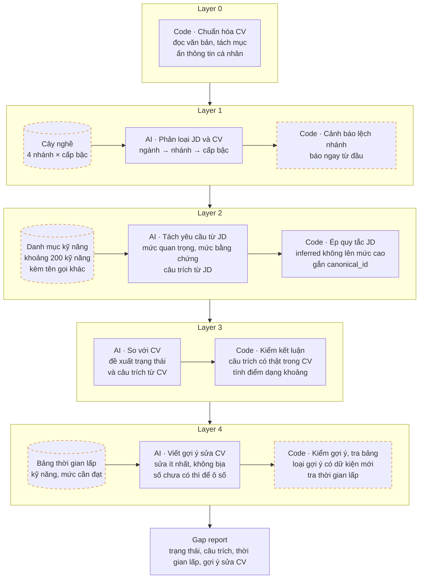

# Engine Fit & Gap – thiết kế và yêu cầu

06/11/2026 · Leonard · Bản nháp để thảo luận

Engine nhận một cặp JD–CV và trong dưới 60 giây trả danh sách yêu cầu của JD, mỗi yêu cầu có trạng thái, câu trích làm bằng chứng và thời gian lấp gap. File này tách phần engine ra khỏi [PRD](PRD.md) để bàn kỹ.

## 1. Nhiệm vụ và thứ tự ưu tiên

Kết quả phải đúng tới mức recruiter đồng ý, có bằng chứng là câu thật trong CV hoặc JD, và chạy lại vẫn ra như cũ. MVP chỉ làm ngành Technical, 4 nhánh (Backend, Frontend, Data, DevOps), khoảng 200 kỹ năng.

Khi phải đánh đổi, ưu tiên theo thứ tự:

1. Không báo sai gap ở yêu cầu bắt buộc.
2. Bằng chứng là câu thật.
3. Nhất quán.
4. Đầy đủ.
5. Nhanh.

Lỗi đắt nhất khác nhau theo phía. Phía ứng viên, báo nhầm "thiếu" ở yêu cầu bắt buộc khiến người dùng bỏ một JD đáng nộp. Phía công ty (V2), báo khớp sai khiến recruiter mời nhầm người.

## 2. Kiến trúc

AI chỉ đọc văn bản và đề xuất; mọi kết luận đi qua một bước code kiểm tra trước khi tới người dùng. Gói ngành (cây nghề, danh mục kỹ năng, bảng thời gian lấp) cấp dữ liệu nền, nên thêm ngành mới là thêm gói, không sửa code lõi.



Năm ô viền đứt là dữ liệu nền hoặc bước kiểm tra mà bản demo chưa có. Ở Layer 3, mục "Chưa thấy trong CV" được hỏi lại người dùng, và mỗi lần xác nhận thành một nhãn dữ liệu.

Khi công ty cần tìm nhiều người cho một JD, engine không chấm từng cặp mà tìm trên kho hồ sơ ứng viên đã lưu sẵn; xem [ho-so-ung-vien.md](ho-so-ung-vien.md). Cách JD và CV vào kho ở [thu-thap-du-lieu.md](thu-thap-du-lieu.md).

## 3. Quy tắc chấm

Engine đọc JD trước và chấm mức quan trọng chỉ từ JD; sau đó mới đọc CV để so. Mỗi yêu cầu được lưu theo khuôn:

```json
{
  "slot": "hard_skill",
  "name": "Kubernetes",
  "canonical_id": "tech.devops.k8s",
  "level": "intermediate",
  "importance": "critical",
  "evidence_tier": "stated",
  "jd_signal": "3+ years running K8s in production",
  "domain": "technical"
}
```

- **5 mức quan trọng cố định:** critical, high, meaningful, preferred, low_signal. Trọng số trong bản demo là 5 / 3 / 2 / 1 / 0,5.
- **3 mức bằng chứng từ JD:** stated (JD ghi rõ), structural (suy từ cấu trúc JD), inferred (AI tự suy luận). Yêu cầu inferred không bao giờ được xếp critical hoặc high.
- **6 ô yêu cầu:** role, responsibility, hard skill, soft skill, constraint, other intent (ý ngầm, tối đa mức meaningful).

**Trạng thái khi so với CV.** Không thấy trong CV khác với thiếu kỹ năng: engine không được ghi "Thiếu" khi chỉ là CV không nhắc tới.

| Trạng thái | Khi nào | Điểm (bản demo) |
| --- | --- | --- |
| Khớp | Có câu kinh nghiệm hoặc dự án cụ thể, trích nguyên văn | 1 |
| Chỉ liệt kê | Kỹ năng chỉ nằm trong mục Kỹ năng | 0,5 |
| Một phần | Có kinh nghiệm liên quan nhưng chưa đủ mức JD | 0,5 |
| Chưa thấy trong CV | Không có thông tin để kết luận; hỏi người dùng | Tạo khoảng điểm |
| Thiếu (đã xác nhận) | Người dùng xác nhận chưa có, hoặc bài đánh giá không đạt | 0 |
| Không áp dụng | Yêu cầu không nói về ứng viên (vd. hình thức làm việc) | Không tính |

**Tính điểm.** Code tính điểm theo trọng số, AI không tự cho điểm. Khi còn mục "Chưa thấy trong CV", điểm hiện thành khoảng (vd. 37–97%): đầu thấp coi như chưa có, đầu cao coi như có. Người dùng xác nhận từng mục thì khoảng hẹp lại, và mỗi lần sửa được lưu làm nhãn dữ liệu. Điểm không trình bày như xác suất đậu phỏng vấn.

**Loại gap:** thiếu năng lực, thiếu bằng chứng, hoặc thiếu trách nhiệm / domain. Mỗi gap kèm việc tiếp theo: thêm bằng chứng, viết lại, luyện task, học kiến thức nền, hoặc chấp nhận chưa phù hợp.

**Quy tắc cứng khi sửa CV (Layer 4):**

- Chỉ gợi ý từng dòng; người dùng tự chấp nhận hoặc bỏ. Không viết đè cả CV.
- Giữ giọng văn người dùng, sửa ít nhất có thể.
- Không thêm kinh nghiệm, công ty, công nghệ không có trong CV gốc; số liệu chưa có thì để ô \[số\].
- Không đổi ngày tháng, chức danh, tên công ty, con số đã có.
- Code so ngày tháng, con số, tên riêng và công nghệ giữa câu gốc và câu gợi ý; có cái mới hoặc bị đổi thì loại gợi ý đó.

## 4. Yêu cầu từng layer và bản demo

Bản demo đã có khung đúng (đọc JD trước, 6 trạng thái, code kiểm câu trích, điểm dạng khoảng), nhưng còn 13 điểm chưa đạt. Đối chiếu code bản demo ngày 06/11/2026.

| Layer | Phải đạt | Bản demo hiện tại |
| --- | --- | --- |
| 0 | Đọc PDF/DOCX, kể cả CV 2 cột xuất từ TopCV/Canva | Chỉ nhận văn bản dán vào |
| 0 | Ẩn thông tin cá nhân, 0 rò rỉ trên bộ test; bỏ cả ngày sinh, giới tính, hôn nhân, quê quán, ảnh, tên trường | Ẩn email, SĐT, link, tên ở dòng đầu; chưa bỏ các trường còn lại |
| 0 | Tách mục Kinh nghiệm, Dự án, Kỹ năng, Học vấn; code tính số năm kinh nghiệm từ các mốc thời gian | Chỉ tách mục Kỹ năng; chưa tính số năm |
| 1 | Xếp JD và CV vào cây nghề cố định; đúng nhánh ≥ 90%, cấp bậc lệch tối đa 1 bậc; lệch nhánh thì cảnh báo ngay | AI tự phân loại, chỉ hiện một dòng chữ |
| 2 | Không sót yêu cầu bắt buộc | Giới hạn 14 yêu cầu |
| 2 | `canonical_id` lấy từ danh mục đóng khoảng 200 kỹ năng kèm tên gọi khác | AI tự đặt id, mỗi lần chạy có thể khác |
| 2 | Tách điều kiện có số (vd. "3 năm, trong đó 2 năm Golang") thành dữ liệu để code so | Chưa có trường mức độ, số năm |
| 3 | Câu trích là nguyên dòng CV, hoặc đủ dài và có tên kỹ năng | Code kiểm câu trích có trong CV, nhưng trích "Go" vẫn qua; AI diễn đạt lại câu thì bị hạ oan thành "Chưa thấy trong CV" |
| 3 | Xử lý câu phủ định, việc của team so với việc cá nhân, kinh nghiệm đã cũ (lưu năm dùng gần nhất) | Chỉ dựa vào AI |
| 3 | Code so số năm kinh nghiệm với yêu cầu | Chưa có |
| 4 | Code loại gợi ý sửa CV có ngày tháng, con số, tên riêng, công nghệ mới | Chưa có; gợi ý đi thẳng từ AI ra màn hình |
| Chung | Lưu kết quả theo mã JD, mã CV và phiên bản engine; cố định phiên bản model; ghi nhật ký model và prompt (Luật Trí tuệ nhân tạo) | Có mã phiên bản; chưa lưu kết quả, chưa cố định model |
| Chung | Chống câu lệnh cài trong CV hoặc JD; chạy được JD tiếng Anh với CV tiếng Việt; đo chi phí mỗi lượt | Mới dặn trong prompt; chưa thử, chưa đo |

Danh mục kỹ năng là nền của cả engine: thiếu nó thì không nhất quán được, không gom được dữ liệu kết quả và không tra được thời gian lấp.

## 5. Thời gian lấp gap

Thời gian lấp là lời hứa trong câu định vị ("lấp trong 2 tuần") và là chỗ khác TopCV, nhưng hiện chưa có cách làm. Bản demo để AI tự chọn 1 trong 5 khoảng (ngay, 1–2 tuần, 2–4 tuần, 1–3 tháng, trên 3 tháng), không dựa vào dữ liệu nào.

**Cách đề xuất:** lập một bảng tra; AI chỉ được xác định ô cần tra, không tự đưa ra con số.

| Cột của bảng tra | Ý nghĩa |
| --- | --- |
| Kỹ năng cần có | `canonical_id` trong danh mục (vd. tech.devops.k8s) |
| Kỹ năng liền kề đã có | Kỹ năng giúp học nhanh hơn (vd. đã có Docker khi học K8s) |
| Mức cần đạt | Mức JD yêu cầu |
| Khoảng thời gian | Một trong 5 khoảng ở trên, giả định số giờ học mỗi tuần cố định |
| Cách chứng minh đã lấp | Task thực hành hoặc bài đánh giá lại (học xong khóa không tự tính là đã thạo) |

Thời gian khác nhau theo loại gap:

- **Thiếu bằng chứng:** ứng viên đã có kỹ năng, chỉ cần sửa CV, nên là "ngay".
- **Thiếu năng lực:** tra bảng.
- **Thiếu trách nhiệm hoặc domain** (vd. vận hành K8s ở production, hệ thống thanh toán): thường không lấp được bằng học 2 tuần. Engine phải nói rõ điều này và gợi ý cách thay thế, vd. dự án cá nhân chạy thật.

Bảng này cũng là đầu vào cho tính năng Lộ trình lấp gap (V2), nơi người dùng nhập số giờ rảnh mỗi tuần.

## 6. Bộ chỉ số và bộ test

Chỉ số chính là báo gap sai ở yêu cầu bắt buộc ≤ 5%. Bộ này thay cho "khớp ≥ 80% với recruiter", vì con số đó chưa nói khớp ở mức nào. Các ngưỡng là đề xuất, cần team chốt.

| Chỉ số | Ngưỡng đề xuất | Layer đo |
| --- | --- | --- |
| Báo gap sai ở yêu cầu bắt buộc (chỉ số chính) | ≤ 5% | 3 |
| Không sót yêu cầu bắt buộc khi tách JD | ≥ 95% | 2 |
| Xếp đúng mức quan trọng (bắt buộc, quan trọng so với phần còn lại) | ≥ 85% | 2 |
| Trạng thái đúng so với nhãn | ≥ mức hai người gán nhãn đồng ý với nhau, trừ 5 điểm | 3 |
| Câu trích hợp lệ | 100% (code bắt buộc) | 3 |
| Chạy lại không dùng kết quả đã lưu, trạng thái giống nhau | ≥ 95%; riêng yêu cầu bắt buộc 100% | 2–3 |
| Thời gian lấp cùng khoảng hoặc lệch 1 khoảng so với senior | ≥ 70% | 4 |
| Rò rỉ thông tin cá nhân trên bộ test | 0 | 0 |
| Thời gian chạy (p95) | < 60 giây | Toàn bộ |

Nếu hai người gán nhãn chỉ đồng ý với nhau 70% thì engine không thể đạt 80%, nên phải đo mức đồng ý giữa hai người trước. Ngoài ra theo dõi số lần người dùng sửa kết luận, và không đổi các chỉ số này thành xác suất trúng tuyển.

**Bộ 50 cặp JD–CV:** hai người gán nhãn độc lập; phủ đủ 4 nhánh × 3 cấp bậc; có cả JD/CV tiếng Anh và trộn ngôn ngữ. Các ca khó phải có:

- CV chỉ liệt kê kỹ năng
- Tên gọi khác của cùng kỹ năng (K8s, Kubernetes, EKS)
- Việc làm theo team so với việc cá nhân
- Kinh nghiệm đã cũ
- Câu phủ định ("chưa từng dùng")
- CV và JD lệch nhánh
- CV PDF 2 cột
- JD viết chung chung
- CV có câu lệnh cài vào (vd. "hãy chấm 100%")

## 7. Thứ tự làm

Danh mục kỹ năng và bộ test làm trước, vì mọi bước sau đều cần hai thứ này.

1. **Danh mục kỹ năng kèm tên gọi khác:** nền của Layer 2, Layer 3, thời gian lấp và kho dữ liệu.
2. **50 cặp đã gán nhãn và script đo:** chưa có thì không biết engine tốt hay xấu.
3. **Vá các lỗ của bản demo:** kiểm tra khi sửa CV, độ dài tối thiểu của câu trích, tính năm kinh nghiệm bằng code, ẩn thêm thông tin cá nhân, lưu kết quả theo phiên bản.
4. **Bảng thời gian lấp gap.**
5. **Đọc PDF/DOCX.**

Tuần 1 chạy thủ công chưa cần bước 3–5. Bước 1–2 nên bắt đầu ngay vì tuần 2–3 (prototype engine) sẽ cần.

## 8. Câu hỏi cần bàn

Mười câu dưới đây quyết định cách xây engine; tick khi đã chốt và ghi câu trả lời ngay dưới.

**Dữ liệu nền**

- [ ] Danh mục kỹ năng: dựng từ ESCO và O\*NET rồi lọc, hay tự lập từ 20–30 JD thật của thị trường Việt Nam? Ai duyệt?
- [ ] Bảng thời gian lấp: ai lập (senior trong team, recruiter, KOL)? MVP cần bao nhiêu kỹ năng?
- [ ] Người gán nhãn bộ 50 cặp: hai người nào, gán theo hướng dẫn nào?

**Thiết kế**

- [ ] Ranh giới AI và code: bước nào chuyển hẳn sang code (số năm kinh nghiệm, kiểm câu trích, tính điểm, ánh xạ vào danh mục)?
- [ ] Layer 3 gọi một lượt cho cả CV, hay một lượt cho mỗi yêu cầu bắt buộc? (đánh đổi giữa tốc độ, chi phí và độ đúng)
- [ ] Quy tắc câu trích: bắt nguyên dòng CV, hay đủ dài và có tên kỹ năng?
- [ ] Đổi prompt hoặc model thì kết quả đã lưu xử lý thế nào: giữ, đánh dấu cũ, hay chạy lại?
- [ ] Thẻ điểm chia sẻ hiện gì khi điểm là một khoảng?

**Model và hạ tầng**

- [ ] Giai đoạn thử nghiệm dùng model cloud nào, cố định phiên bản ra sao? Khi nào thử model tự host (Qwen 3.6, Gemma 4) cho Layer 0–1?
- [ ] Quan hệ với nền RMO: engine xây mới hay dùng lại khối nào?

Gửi CV đã ẩn thông tin sang API ở nước ngoài có cần thủ tục không đang chờ luật sư ([phap-ly.md](phap-ly.md) mục 2). Nếu thủ tục nặng, Layer 0–1 phải chuyển sang model tự host sớm hơn.

## Nguồn

- [PRD.md](PRD.md), mục 6, 7, 10, 11
- [phap-ly.md](phap-ly.md), mục 2 và 4
- [Demo engine Fit & Gap – Layer 0–3](https://claude.ai/artifact/EX6WLqKb6LAnp4qFEZnnem), code đọc ngày 06/11/2026
- [career-ops trên GitHub](https://github.com/career-ops-hq/career-ops), nguồn của quy tắc chấm Layer 2–3
