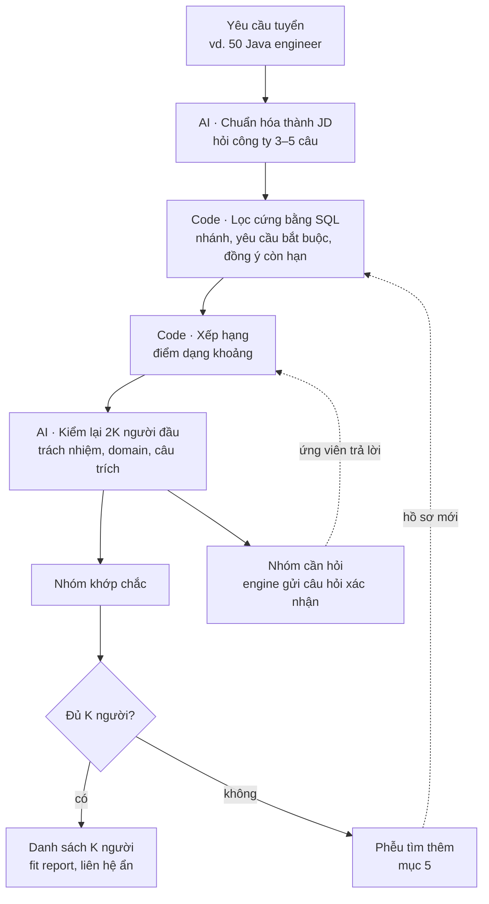

# Hồ sơ ứng viên và tìm ứng viên trên kho – thiết kế

06/11/2026 · Leonard · Bản nháp để thảo luận · cập nhật 08/11/2026

Khi công ty cần 30–50 người cho một JD, engine phải trả danh sách nhanh, đúng và rẻ. Hiện engine chỉ chấm từng cặp JD–CV ([engine.md](engine.md)). Nếu chạy cách đó trên cả kho CV, chi phí sẽ tăng theo kích thước kho và lặp lại ở mỗi JD. File này mô tả ba phần: lưu hồ sơ ứng viên một lần khi nhận CV, tìm K người trên kho bằng code trước rồi mới dùng AI, và làm đầy kho bằng những nguồn có đồng ý của ứng viên.

## 1. Bài toán và thứ tự ưu tiên

**Đầu vào:** công ty gửi một yêu cầu tuyển, vd. "cần 50 Java engineer". **Đầu ra:** danh sách K người kèm fit report, liên hệ ẩn tới khi công ty bấm mời.

"Chi phí" trong file này là chi phí chạy engine, tức số lượt gọi AI nhân với độ dài văn bản đưa vào mỗi lượt.

Khi phải đánh đổi, ưu tiên theo thứ tự:

1. Không báo khớp sai. Phía công ty, lỗi đắt nhất là mời nhầm người ([engine.md](engine.md) mục 1).
2. Không bỏ sót người khớp đang có trong kho.
3. Chi phí chạy engine thấp.
4. Nhanh.

**Ngoài phạm vi:** so khớp chi tiết một cặp JD–CV (đã có trong engine.md), luyện phỏng vấn, ngành xuất khẩu lao động (cần gói ngành riêng, xem mục 9), tự động nhắn tin.

## 2. Nguyên tắc: AI chạy một lần khi nhận CV

Phần AI đắt nhất của việc đọc CV được dời về lúc nhận CV và chỉ chạy một lần. Mỗi yêu cầu tuyển chỉ tốn AI ở hai chỗ: tách yêu cầu và kiểm lại nhóm đứng đầu.

| Thời điểm | Việc | Lượt AI |
| --- | --- | --- |
| Nhận CV (mỗi CV một lần) | Layer 0–1, đọc CV: tách mục, ẩn thông tin cá nhân, gắn kỹ năng vào `canonical_id`, tính số năm, lưu câu trích | 1–2 cho mỗi CV |
| Có yêu cầu tuyển | Layer 2 tách yêu cầu từ JD | 1 |
| Lọc cứng | SQL trên kho hồ sơ | 0 |
| Xếp hạng | Code tính điểm theo trọng số 5 / 3 / 2 / 1 / 0,5 | 0 |
| Kiểm lại | AI soát 2K người đứng đầu | 2K |

Ví dụ với kho 10.000 hồ sơ và K = 30, mỗi yêu cầu tốn khoảng 61 lượt AI, thay vì 10.000 lượt nếu chấm từng cặp. Chi phí nhận CV là chi phí cố định: trả một lần, dùng lại cho mọi yêu cầu sau.

## 3. Hai lớp dữ liệu: lead và hồ sơ

Hai lớp tách riêng: người mới được liên hệ thì chỉ là **lead**, người đã đồng ý thì mới có **hồ sơ**.

### 3.1 Lead

Lead là người mình đã nhắn tin nhưng chưa đồng ý. Lead không chứa nội dung profile và không đi qua AI, trừ chế độ chấm tạm ở mục 5.3.

```json
{
  "lead_id": "l_41c",
  "profile_url": "linkedin.com/in/…",
  "source": "linkedin_manual",
  "request_id": "req_java_50",
  "contacted_at": "2026-11-06",
  "status": "contacted",
  "expires_at": "2026-12-06"
}
```

`status` có 5 giá trị: contacted, replied, declined, converted (đã gửi CV, có hồ sơ), expired. Hết 30 ngày không phản hồi thì lead tự xóa.

### 3.2 Hồ sơ ứng viên

Hồ sơ chỉ được tạo khi ứng viên đã gửi CV và tick ô đồng ý. Hồ sơ lưu **bằng chứng** của từng kỹ năng, không chỉ lưu việc "có kỹ năng".

```json
{
  "candidate_id": "c_8f2a",
  "cv_hash": "sha256:…",
  "engine_version": "0.3",
  "catalog_version": "2026-11",
  "source": "free_tool",
  "branch": ["backend"],
  "level": "mid",
  "total_years": 4.5,
  "skills": [
    {
      "canonical_id": "tech.lang.go",
      "evidence": "experience",
      "years": 2.0,
      "last_used": 2026,
      "quote": "Xây dựng payment service bằng Go…",
      "user_confirmed": null
    },
    {
      "canonical_id": "tech.devops.k8s",
      "evidence": "listed_only",
      "years": null,
      "last_used": null,
      "quote": "Skills: Docker, K8s",
      "user_confirmed": true
    }
  ],
  "experience_lines": ["…các dòng kinh nghiệm đã ẩn thông tin cá nhân…"],
  "consent": {
    "this_request": true,
    "searchable": true,
    "searchable_expires": "2027-05-06"
  },
  "availability": "open",
  "updated_at": "2026-11-06"
}
```

| Trường | Vì sao cần |
| --- | --- |
| `evidence` | Có 3 giá trị: experience, project, listed_only. Ứng với các trạng thái Khớp, Một phần, Chỉ liệt kê ở [engine.md](engine.md) mục 3. Thiếu trường này thì SQL coi "chỉ liệt kê K8s" ngang với "vận hành K8s ở production" |
| `user_confirmed` | true / false / null. Là câu trả lời của ứng viên cho mục "Chưa thấy trong CV", dùng lại được cho mọi JD sau. Hỏi ứng viên một câu rẻ hơn một lượt AI |
| `years`, `last_used` | Code so điều kiện "3 năm, trong đó 2 năm Go" và xử lý kinh nghiệm đã cũ |
| `cv_hash`, `catalog_version`, `engine_version` | CV, danh mục kỹ năng hoặc engine đổi thì đánh dấu hồ sơ là cũ |
| `experience_lines` | Gắn lại kỹ năng bằng code khi danh mục đổi; sau này thêm tìm theo vector mà không phải đọc lại CV (mục 4.4) |
| `consent` | `searchable` là ô đồng ý thứ hai ở mục 5.2. Bằng false hoặc đã hết hạn thì không xuất hiện trong kết quả tìm kiếm |
| `availability` | open / not_looking / hired. Đẩy người đã có việc cho công ty là lãng phí lượt mời |

Ứng viên tự gửi CV mới hoặc xác nhận lại thì hồ sơ được làm mới. Hết hạn `searchable_expires` thì hỏi ứng viên có muốn gia hạn không; không gia hạn thì hồ sơ bị ẩn khỏi tìm kiếm và xóa theo chính sách lưu trữ ([phap-ly.md](phap-ly.md) mục 2).

### 3.3 Nhận diện một người và xác minh chủ CV

Một người có thể vào kho nhiều lần: qua tool miễn phí, qua PDF LinkedIn, qua link mời. `cv_hash` chỉ nhận ra cùng một file, không nhận ra cùng một người. Engine không cào CV ([thu-thap-du-lieu.md](thu-thap-du-lieu.md) mục 1), nên ai có hồ sơ cũng đã ít nhất một lần tự gửi CV và tick đồng ý. Việc nhận diện dựa vào đúng lần tương tác đó.

**Mã định danh.** Không trường nào đủ tin cậy khi dùng một mình, nên mỗi người có nhiều mã:

| Mã | Độ mạnh | Ghi chú |
| --- | --- | --- |
| SĐT, chuẩn hóa về +84 | Rất mạnh | Gần như CV nào cũng có. Đổi đầu số cũ 11 số (0168… → 038…) trước khi so |
| Email, chuẩn hóa | Mạnh | Một người có nhiều email; Gmail bỏ dấu chấm và phần `+tag` |
| URL profile (LinkedIn) | Trung bình | Người dùng đổi được slug; lưu thêm member URN nếu có |
| Chuỗi công ty + chức danh + mốc thời gian | Yếu | Chỉ để gợi ý "có thể trùng", không tự gộp |
| Tên + ngày sinh | Không dùng | Layer 0 đã bỏ ngày sinh; trùng tên rất nhiều |

```
person_identifier(person_id, type, value_hmac, verified, source, cv_document_id, first_seen)
```

Giá trị lưu bằng HMAC có khóa bí mật, không dùng sha256 trần: không gian SĐT Việt Nam chỉ khoảng 10⁹ số, nên băm trần dò ngược được trong vài phút. Giá trị gốc chỉ nằm trong kho thông tin cá nhân (`pii_vault`, mục 3.4); mỗi lần mở đều ghi nhật ký ai mở, lúc nào, cho yêu cầu tuyển nào.

**Quy tắc gộp.** Gộp nhầm tệ hơn để trùng, vì hồ sơ, liên hệ và đồng ý của người này sẽ lẫn sang người khác.

1. Tự gộp chỉ khi khớp một mã có `verified = true`.
2. Khớp mã chưa xác minh (SĐT hoặc email chỉ ghi trong CV): đánh dấu "có thể trùng", hỏi lại khi người đó xác minh.
3. Mã xuất hiện trên hơn N người là mã dùng chung (agency, người gửi hộ, hr@ của công ty), bị loại khỏi việc gộp.
4. Khi gộp, CV và bằng chứng gom về một `person_id`. Đồng ý không gộp: giữ riêng theo từng lần tick, `searchable` lấy theo lần mới nhất còn hạn.

**Xác minh chủ CV.** Ai cũng tải được CV của người khác lên tool và tick đồng ý thay họ. Đồng ý chỉ có giá trị khi chính chủ thể dữ liệu đồng ý, nên cần chứng minh người tick là chủ CV. Việc xác minh này cũng là điều kiện để ứng viên thực hiện quyền xem, sửa, rút đồng ý, xóa hồ sơ; để gộp hồ sơ an toàn; và để chắc liên hệ còn dùng được trước khi công ty bấm mời.

- Khi ứng viên tick ô thứ hai (mục 5.2), gửi link xác nhận tới email ghi trong CV, hoặc OTP tới SĐT. Link qua email rẻ hơn SMS hay Zalo ZNS.
- Chưa bấm link thì `searchable` chưa có hiệu lực: hồ sơ chưa xuất hiện trong kết quả tìm kiếm.
- Người chỉ tick ô thứ nhất (chỉ dùng thử tool) không phải xác minh, vì hồ sơ không vào kho.
- Không cần tài khoản hay mật khẩu.

**Lead thành hồ sơ.** Tin nhắn mời kèm link có token gắn với `lead_id`. Ứng viên bấm link, gửi CV và tick đồng ý, nên engine biết hồ sơ mới thuộc lead nào mà không phải đoán. Lead không có mã đã xác minh, nên không bao giờ tự gộp với hồ sơ có sẵn.

```
lead (profile_url) ──link mời có token──▶ cv_document + consent ──xác minh──▶ person_identifier (verified) ──▶ person
```

### 3.4 Cách lưu trong PostgreSQL (đề xuất, chưa chốt)

JSON ở mục 3.2 là cách nhìn logic của một hồ sơ. Lưu nguyên khối đó thành một cột JSONB thì câu lọc kiểu "Go, bằng chứng experience, ≥ 2 năm, dùng gần nhất ≥ 2024" khó viết và khó đánh index. Khối đó cũng đang trộn ba nguồn dữ liệu có vòng đời khác nhau:

| Nguồn | Ví dụ | Khi danh mục kỹ năng hoặc engine đổi |
| --- | --- | --- |
| Đọc từ CV (AI + code) | Đoạn kinh nghiệm, câu trích, skill đã gắn `canonical_id` | Gắn lại skill bằng code, hoặc chạy lại từ kho thô |
| Ứng viên khai | Câu trả lời xác nhận, nguyện vọng, lương mong muốn, đồng ý | Không bao giờ bị ghi đè |
| Code tính ra | Tổng số năm, `last_used`, mức bằng chứng tốt nhất | Xóa đi tính lại bất cứ lúc nào |

Câu trả lời của ứng viên là dữ liệu đắt nhất, vì phải chờ người thật trả lời; trộn chung thì chạy lại engine có thể xóa mất. Đề xuất cách lưu lai: JSONB cho kết quả thô của AI, bảng quan hệ cho những gì SQL phải lọc, bảng chỉ thêm dòng cho những gì ứng viên khai.

| Bảng | Nội dung |
| --- | --- |
| `person`, `person_identifier` | Danh tính để gộp trùng (mục 3.3) |
| `pii_vault` | Schema riêng: tên, liên hệ; mỗi lần mở đều ghi nhật ký |
| `cv_document` | Mỗi CV một dòng: `cv_hash`, nguồn (free_tool, linkedin_pdf, outreach, tailored), `parent_cv_id` cho CV đã sửa theo JD |
| `extraction` | JSONB thô theo (CV, `engine_version`, model); không sửa sau khi ghi |
| `experience` | Đoạn kinh nghiệm: vai trò, từ–đến, domain, quy mô team, việc cá nhân hay của team |
| `skill_evidence` | Mỗi lần skill xuất hiện một dòng: `experience_id`, `canonical_id`, `evidence`, vị trí câu trích |
| `candidate_assertion` | Ứng viên khai: `canonical_id`, câu hỏi đã gửi (kèm mức và số năm JD hỏi), câu trả lời, ngày; chỉ thêm dòng |
| `assessment` | Kết quả bài đánh giá, nếu có |
| `candidate_pref` | Địa điểm, remote, lương mong muốn, thời gian báo nghỉ, vai trò muốn làm |
| `consent` | Mỗi lần đồng ý, rút lại hoặc gia hạn là một dòng mới |
| `skill_summary` | Bảng tính sẵn (materialized): (người, `canonical_id`) → tổng năm, `last_used`, mức bằng chứng tốt nhất, đã xác nhận chưa. Index cho lọc cứng ở mục 4.2; xóa đi tính lại được |

Cách này gỡ được mấy chỗ hở của mục 3.2:

- `years` tính từ nhiều dòng `skill_evidence`, có xử lý các khoảng thời gian chồng nhau, thay vì một con số gộp.
- `user_confirmed` thành `candidate_assertion`: nhớ ứng viên đã trả lời câu hỏi nào, nên "có K8s" khác "2 năm K8s ở production".
- `experience` có domain và quy mô, nên SQL bắt đầu lọc được theo domain, bớt phụ thuộc bước AI kiểm lại ở mục 4.3.
- Đổi danh mục kỹ năng thì chạy lại code trên `extraction` và `experience`, không tốn lượt AI.
- `candidate_pref` cho bước lọc cứng dùng được các câu trả lời về địa điểm và lương ở mục 4.1.

## 4. Tìm K người cho một yêu cầu tuyển



### 4.1 Chuẩn hóa yêu cầu

"50 Java engineer" là JD viết chung chung, một ca khó trong bộ test của engine.md. Engine dựng nháp danh sách yêu cầu theo Layer 2, rồi hỏi công ty các câu: cấp bậc, số năm, địa điểm hoặc remote, domain, khoảng lương. Công ty chốt tiêu chí xong mới bắt đầu tìm. Đổi tiêu chí thì các kết quả cũ bị đánh dấu là cũ (PRD mục 4, tính năng 15).

### 4.2 Lọc cứng và xếp hạng

**Lọc cứng** chỉ dùng điều kiện rõ ràng:

- Đúng nhánh hoặc nhánh liền kề.
- `searchable = true`, còn hạn, `availability = open`.
- Với yêu cầu critical: loại người có `user_confirmed = false`. Người có "Chưa thấy" thì **không bị loại**.
- Số năm: chỉ loại khi CV có ghi số năm và thấp hơn yêu cầu. CV không ghi số năm không tự thành "không đủ năm".

**Xếp hạng** dùng cùng công thức điểm dạng khoảng của engine.md mục 3. Kết quả chia hai nhóm:

- **Khớp chắc:** xếp theo đầu thấp của khoảng, vì phía công ty phải tránh báo khớp sai.
- **Cần hỏi:** đầu cao của khoảng cao nhưng đầu thấp còn thấp vì có mục "Chưa thấy". Engine tự gửi câu hỏi xác nhận cho ứng viên (không tốn AI). Ứng viên trả lời thì `user_confirmed` được ghi vào hồ sơ và người đó được xếp lại.

### 4.3 AI kiểm lại 2K người đầu

AI kiểm những thứ SQL không làm được: yêu cầu thuộc ô responsibility và domain, việc của team so với việc cá nhân, câu phủ định, câu trích có đúng nghĩa không. Người bị hạ thì lấy thêm người kế tiếp trong danh sách xếp hạng. Mọi kết luận vẫn đi qua bước code kiểm tra như Layer 3.

### 4.4 Lối mở cho tìm theo vector

MVP chỉ dùng lọc có cấu trúc (hướng A). Nếu bộ test cho thấy bước lọc sót người, vd. ở yêu cầu domain như "hệ thống thanh toán" hoặc kỹ năng ngoài danh mục, thì thêm embedding trên `experience_lines` (pgvector) làm lưới vét. Lưới này chỉ kéo thêm người vào nhóm được AI kiểm lại, không thay bước lọc có cấu trúc (hướng C). Vì `experience_lines` đã được lưu từ đầu, việc thêm vector không cần đọc lại toàn bộ CV.

## 5. Phễu tìm thêm khi kho thiếu

Nguyên tắc: **xem profile và liên hệ thì được; lưu và xử lý thì đợi ứng viên đồng ý.**

### 5.1 Các bước

| # | Bước | Ai làm | Engine làm gì | Lưu gì |
| --- | --- | --- | --- | --- |
| 1 | Soạn chuỗi tìm kiếm | Engine | Sinh chuỗi tìm kiếm LinkedIn dạng boolean từ JD đã chuẩn hóa, kèm 3–4 dấu hiệu để lọc nhanh bằng mắt | — |
| 2 | Xem từng profile và chọn người để nhắn | Người của mình | Chưa làm gì; chấm tạm (mục 5.3) chờ luật sư | — |
| 3 | Nhắn tin giới thiệu JD | Người của mình bấm gửi | Soạn tin theo JD: vị trí, khoảng lương, điểm hấp dẫn, vì sao chọn họ; kèm link mời có token `lead_id` | Lead (chưa có điểm), nội dung tin mời |
| 4 | Ứng viên quan tâm, gửi CV hoặc PDF LinkedIn | Ứng viên | Form nhận CV qua link mời, có hai ô đồng ý (mục 5.2) và bước xác minh chủ CV (mục 3.3) | Hồ sơ, `source = outreach` |
| 5 | Chấm và sửa CV theo JD | Engine, ứng viên duyệt | Gap report; gợi ý sửa từng dòng theo quy tắc Layer 4 | Kết quả chấm, các dòng đã sửa |
| 6 | Ứng viên đồng ý nộp | Ứng viên | — | Đồng ý cho JD này |
| 7 | Đẩy về công ty | Engine | CV đã sửa kèm fit report; liên hệ ẩn tới khi công ty bấm mời | — |
| 8 | Theo dõi kết quả | Người của mình | Ghi kết quả: được gọi phỏng vấn, offer, bị loại | Nhãn kết quả |

Ứng viên quan tâm nhưng khớp thấp thì **không đẩy về công ty**. Họ vẫn nhận gap report và ở lại kho nếu đã tick ô thứ hai.

Hồ sơ chỉ dựng từ CV ứng viên gửi ở bước 4. Những gì người của mình xem được ở bước 2 không được trộn vào hồ sơ: đồng ý ở bước 4 có hiệu lực từ lúc ứng viên gửi CV, không hợp thức hóa ngược việc xem và đánh giá trước đó.

**Mức tự động của bước 1–2, đã chốt 08/11/2026: mức A.**

| Mức | Cách làm | Quyết định |
| --- | --- | --- |
| A | Engine soạn chuỗi tìm kiếm; người của mình xem từng profile, chọn người, bấm gửi từng tin. Lead chỉ lưu URL, không lưu điểm | **Làm**, giai đoạn 0–1. Chậm: một người làm được khoảng 50–100 tin mỗi ngày |
| B | Như A, cộng chấm tạm không lưu (mục 5.3) | Chờ luật sư |
| C | Cào tự động hàng loạt profile rồi chấm, lập danh sách người phù hợp | **Không làm.** Danh sách người kèm điểm đã là dữ liệu đánh giá một người chưa đồng ý, dù không lưu nội dung profile. Các trang đều phát hiện và khóa tài khoản cào, mất tài khoản là mất luôn kênh nhắn tin |

**Nơi tìm người để nhắn.** Không riêng LinkedIn có điều khoản: luật bảo vệ dữ liệu cá nhân áp lên dữ liệu của người đó, không áp lên nền tảng, nên đổi nguồn không đổi nguyên tắc. Xem và liên hệ từng người thì được; cào và lưu khi chưa đồng ý thì không.

| Nguồn | Dùng thế nào | Cảnh báo |
| --- | --- | --- |
| LinkedIn | Xem profile, nhắn từng người | Không tự động quét, không gửi tin hàng loạt ([phap-ly.md](phap-ly.md) mục 6) |
| Nhóm Facebook, Zalo, Discord IT | Đăng JD; người quan tâm tự nhắn tới (mục 6) | Nguồn sạch nhất, người tới đã muốn tìm việc |
| GitHub | Xem portfolio để đánh giá người đã chọn | Chính sách sử dụng của GitHub cấm dùng thông tin trên đó để gửi tin không mời, kể cả cho recruiter. Không lấy email từ GitHub để nhắn |
| Kho CV của TopCV, ITviec, VietnamWorks | Chỉ khi điều khoản cho phép | Tài khoản nhà tuyển dụng thường chỉ được dùng để tuyển cho chính công ty mua; đem đi giới thiệu cho bên khác nhiều khả năng vi phạm. Đọc điều khoản trước |

Layer 0 đọc được file PDF từ nút "Save to PDF" của LinkedIn, nên cũng dùng được cho tính năng 14 (chấm LinkedIn profile).

### 5.2 Hai ô đồng ý

- ☐ Cho phép xử lý CV để ứng tuyển **JD này**. Bắt buộc.
- ☐ Cho phép giữ hồ sơ để giới thiệu **JD phù hợp khác** trong 6 tháng. Không bắt buộc.

Kho chỉ lớn lên nhờ ô thứ hai. Ứng viên cần thấy lợi ích ngay: dù không khớp JD này, họ vẫn nhận gap report miễn phí và được báo khi có JD hợp hơn.

### 5.3 Chấm tạm, không lưu (chờ luật sư)

Người của mình dán một profile công khai vào. Engine ẩn thông tin cá nhân, chấm theo JD đang tuyển, và chỉ trả về "nên nhắn / không nên nhắn" kèm lý do. Profile không được lưu và không vào kho; chỉ lead được ghi khi quyết định nhắn. Chế độ này giúp chọn đúng người để nhắn, nhưng vẫn là xử lý dữ liệu cá nhân khi người đó chưa đồng ý. Chưa bật cho tới khi luật sư trả lời (mục 9).

## 6. Nguồn làm đầy kho

Muốn trả kết quả nhanh thì kho phải có sẵn hồ sơ trước khi công ty hỏi. Tìm từ đầu thì mất nhiều ngày, vì phải chờ người trả lời.

| Nguồn | Cách vào kho | Giai đoạn |
| --- | --- | --- |
| Tool quét gap miễn phí | Ứng viên tick ô thứ hai sau khi nhận kết quả | MVP |
| Ứng viên tự tải PDF LinkedIn | Layer 0 đọc định dạng "Save to PDF" | MVP |
| Ứng viên tự tìm tới | Đăng JD vào nhóm Facebook, Zalo, Discord IT và qua KOL; người quan tâm gửi CV qua form có hai ô đồng ý. Báo cho người trong kho khi có JD hợp hơn cũng thuộc nguồn này | MVP |
| Ứng viên giới thiệu bạn bè | Người trong kho gửi link mời cho bạn; thưởng khi tuyển được | Sau khi có giấy phép dịch vụ việc làm |
| Luồng ứng tuyển hộ | Phễu ở mục 5 | Sau khi có giấy phép dịch vụ việc làm |
| Kho CV của chính công ty | Công ty đưa CV cũ, ATS của họ vào; chỉ dùng cho công ty đó | V2 |

**Không làm:** cào profile LinkedIn về kho. Lý do: vi phạm điều khoản LinkedIn; lưu và xử lý dữ liệu cá nhân khi chưa có đồng ý; và kho cào về không có `consent` lẫn `availability`, nên không biết người đó còn tìm việc không.

Cách dữ liệu vào kho (crawler JD, nhận CV, kho thô và kho tinh, hàng đợi xử lý) ở [thu-thap-du-lieu.md](thu-thap-du-lieu.md).

## 7. Bộ chỉ số

Các ngưỡng là đề xuất, cần team chốt.

| Chỉ số | Ngưỡng đề xuất | Cách đo |
| --- | --- | --- |
| Không sót người khớp ở bước lọc và xếp hạng | ≥ 95% | Trên một mẫu hồ sơ, chạy Layer 3 đầy đủ cho mọi cặp, rồi so với danh sách 2K mà bước lọc chọn |
| Báo khớp sai trong danh sách gửi công ty | ≤ 5% | Công ty hoặc người gán nhãn đánh dấu người không đạt yêu cầu bắt buộc |
| Lượt AI mỗi yêu cầu tuyển | ≤ 2K + 1 | Nhật ký engine |
| Thời gian trả kết quả từ kho (p95) | < 60 giây | Không tính thời gian chờ ứng viên trả lời |
| Tỷ lệ tick ô đồng ý thứ hai | Theo dõi | Form nhận CV |
| Phễu theo từng yêu cầu | Theo dõi | Đã nhắn → trả lời → gửi CV → khớp → được nộp → phỏng vấn → offer |

Sau vài đợt, phễu cho ra tỷ lệ thật để trả lời câu "cần 50 người thì phải nhắn bao nhiêu và mất mấy ngày", đồng thời làm cơ sở báo giá cho công ty.

## 8. Thứ tự làm

Phần này phụ thuộc danh mục kỹ năng (bước 1 của [engine.md](engine.md) mục 7): chưa có `canonical_id` cố định thì không lọc bằng SQL được.

1. **Schema hồ sơ và lead** trên PostgreSQL.
2. **Bước nhận CV ghi hồ sơ:** dùng lại Layer 0–1 và nửa đọc CV của Layer 3.
3. **Truy vấn lọc và xếp hạng,** đo tỷ lệ không sót người trên bộ test.
4. **Form nhận CV có hai ô đồng ý** và bảng lead tự xóa.
5. **AI kiểm lại 2K người,** nhóm cần hỏi và câu hỏi xác nhận gửi ứng viên.
6. **Đo phễu** theo từng yêu cầu tuyển.

## 9. Câu hỏi cần bàn

Tick khi đã chốt và ghi câu trả lời ngay dưới.

**Thiết kế**

- [ ] Số người AI kiểm lại là 2K, hay chọn theo độ tin của điểm (vd. kiểm tới khi đủ K người khớp chắc)?
- [ ] Thời hạn giữ hồ sơ 6 tháng và thời hạn giữ lead 30 ngày có hợp lý không?
- [ ] Gửi câu hỏi xác nhận cho ứng viên qua kênh nào (Zalo, email, trong tool)?
- [ ] Khi nào thêm tìm theo vector: cứ chờ số liệu sót người, hay đặt sẵn một mốc?
- [ ] Xác minh chủ CV (mục 3.3): chỉ link qua email, OTP qua SĐT, hay cả hai? Ngưỡng N để coi một mã là mã dùng chung?
- [ ] Cách lưu lai ở mục 3.4: chốt để đi vào chi tiết từng bảng, bắt đầu từ `experience` và `skill_evidence`.
- [x] Không cào CV vào kho; mọi hồ sơ đều qua một lần ứng viên tự gửi CV và tick đồng ý. Chốt 08/11/2026.
- [x] Bước tìm người để nhắn dùng mức A ở mục 5.1 (thủ công, không cào). Chốt 08/11/2026.

**Pháp lý** (bổ sung vào [phap-ly.md](phap-ly.md) mục 8)

- [ ] Chấm tạm, không lưu một profile công khai trước khi nhắn tin có cần căn cứ pháp lý riêng không?
- [ ] Hai ô đồng ý ở mục 5.2 đã đủ cho mục đích "giữ hồ sơ để giới thiệu JD khác" chưa?
- [ ] Xác minh qua link gửi tới email hoặc SĐT ghi trong CV có đủ để chứng minh đồng ý là của chủ thể dữ liệu không?
- [ ] Gửi hồ sơ đã ẩn thông tin cá nhân sang API AI ở nước ngoài (đang chờ ở mục 2).

**Kinh doanh**

- [ ] Thu phí công ty theo người được nộp hay theo người được tuyển ([PRD.md](PRD.md) mục 8)?
- [ ] Ngành xuất khẩu lao động: cần gói ngành riêng. Yêu cầu tuyển ở ngành này hay có tuổi, sức khỏe, chiều cao, chứng chỉ tiếng, trong khi Layer 0 đang ẩn ngày sinh và giới tính. Cần quy tắc riêng: trường nhạy cảm chỉ được dùng khi chính yêu cầu tuyển hợp pháp đòi hỏi.

## Nguồn

- [engine.md](engine.md), mục 1, 3, 7
- [PRD.md](PRD.md), mục 4 (tính năng 13, 14, 15), mục 5 (luồng công ty, luồng ứng tuyển hộ), mục 8
- [phap-ly.md](phap-ly.md), mục 2, 5, 6, 8
- [chien-luoc.md](chien-luoc.md): mô hình headhunter và các giai đoạn dùng kho hồ sơ này
- [GitHub Acceptable Use Policies](https://docs.github.com/en/site-policy/acceptable-use-policies/github-acceptable-use-policies), mục giới hạn sử dụng thông tin
