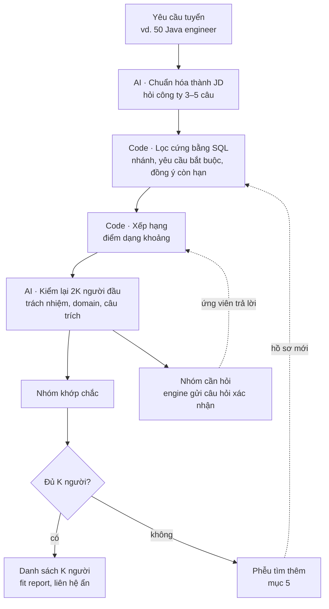

# Hồ sơ ứng viên và tìm ứng viên trên kho – thiết kế

06/11/2026 · Leonard · Bản nháp để thảo luận

Khi công ty cần 30–50 người cho một JD, engine phải trả danh sách nhanh, đúng và rẻ. Hiện engine chỉ chấm từng cặp JD–CV ([engine.md](engine.md)). Nếu chạy cách đó trên cả kho CV, chi phí sẽ tăng theo kích thước kho và lặp lại ở mỗi JD. File này mô tả ba phần: lưu hồ sơ ứng viên một lần khi nhận CV, tìm K người trên kho bằng code trước rồi mới dùng AI, và làm đầy kho bằng những nguồn có đồng ý của ứng viên.

## 1. Bài toán và thứ tự ưu tiên

**Đầu vào:** công ty gửi một yêu cầu tuyển, vd. "cần 50 Java engineer". **Đầu ra:** danh sách K người kèm fit report, liên hệ ẩn tới khi công ty bấm mời.

"Chi phí" trong file này là chi phí chạy engine, tức số lượt gọi AI nhân với độ dài văn bản đưa vào mỗi lượt.

Khi phải đánh đổi, ưu tiên theo thứ tự:

1. Không báo khớp sai. Phía công ty, lỗi đắt nhất là mời nhầm người ([engine.md](engine.md) mục 1).
2. Không bỏ sót người khớp đang có trong kho.
3. Chi phí chạy engine thấp.
4. Nhanh.

**Ngoài phạm vi:** so khớp chi tiết một cặp JD–CV (đã có trong engine.md), luyện phỏng vấn, ngành xuất khẩu lao động (cần gói ngành riêng, xem mục 9), tự động nhắn tin.

## 2. Nguyên tắc: AI chạy một lần khi nhận CV

Phần AI đắt nhất của việc đọc CV được dời về lúc nhận CV và chỉ chạy một lần. Mỗi yêu cầu tuyển chỉ tốn AI ở hai chỗ: tách yêu cầu và kiểm lại nhóm đứng đầu.

| Thời điểm | Việc | Lượt AI |
| --- | --- | --- |
| Nhận CV (mỗi CV một lần) | Layer 0–1, đọc CV: tách mục, ẩn thông tin cá nhân, gắn kỹ năng vào `canonical_id`, tính số năm, lưu câu trích | 1–2 cho mỗi CV |
| Có yêu cầu tuyển | Layer 2 tách yêu cầu từ JD | 1 |
| Lọc cứng | SQL trên kho hồ sơ | 0 |
| Xếp hạng | Code tính điểm theo trọng số 5 / 3 / 2 / 1 / 0,5 | 0 |
| Kiểm lại | AI soát 2K người đứng đầu | 2K |

Ví dụ với kho 10.000 hồ sơ và K = 30, mỗi yêu cầu tốn khoảng 61 lượt AI, thay vì 10.000 lượt nếu chấm từng cặp. Chi phí nhận CV là chi phí cố định: trả một lần, dùng lại cho mọi yêu cầu sau.

## 3. Hai lớp dữ liệu: lead và hồ sơ

Hai lớp tách riêng: người mới được liên hệ thì chỉ là **lead**, người đã đồng ý thì mới có **hồ sơ**.

### 3.1 Lead

Lead là người mình đã nhắn tin nhưng chưa đồng ý. Lead không chứa nội dung profile và không đi qua AI, trừ chế độ chấm tạm ở mục 5.3.

```json
{
  "lead_id": "l_41c",
  "profile_url": "linkedin.com/in/…",
  "source": "linkedin_manual",
  "request_id": "req_java_50",
  "contacted_at": "2026-11-06",
  "status": "contacted",
  "expires_at": "2026-12-06"
}
```

`status` có 5 giá trị: contacted, replied, declined, converted (đã gửi CV, có hồ sơ), expired. Hết 30 ngày không phản hồi thì lead tự xóa.

### 3.2 Hồ sơ ứng viên

Hồ sơ chỉ được tạo khi ứng viên đã gửi CV và tick ô đồng ý. Hồ sơ lưu **bằng chứng** của từng kỹ năng, không chỉ lưu việc "có kỹ năng".

```json
{
  "candidate_id": "c_8f2a",
  "cv_hash": "sha256:…",
  "engine_version": "0.3",
  "catalog_version": "2026-11",
  "source": "free_tool",
  "branch": ["backend"],
  "level": "mid",
  "total_years": 4.5,
  "skills": [
    {
      "canonical_id": "tech.lang.go",
      "evidence": "experience",
      "years": 2.0,
      "last_used": 2026,
      "quote": "Xây dựng payment service bằng Go…",
      "user_confirmed": null
    },
    {
      "canonical_id": "tech.devops.k8s",
      "evidence": "listed_only",
      "years": null,
      "last_used": null,
      "quote": "Skills: Docker, K8s",
      "user_confirmed": true
    }
  ],
  "experience_lines": ["…các dòng kinh nghiệm đã ẩn thông tin cá nhân…"],
  "consent": {
    "this_request": true,
    "searchable": true,
    "searchable_expires": "2027-05-06"
  },
  "availability": "open",
  "updated_at": "2026-11-06"
}
```

| Trường | Vì sao cần |
| --- | --- |
| `evidence` | Có 3 giá trị: experience, project, listed_only. Ứng với các trạng thái Khớp, Một phần, Chỉ liệt kê ở [engine.md](engine.md) mục 3. Thiếu trường này thì SQL coi "chỉ liệt kê K8s" ngang với "vận hành K8s ở production" |
| `user_confirmed` | true / false / null. Là câu trả lời của ứng viên cho mục "Chưa thấy trong CV", dùng lại được cho mọi JD sau. Hỏi ứng viên một câu rẻ hơn một lượt AI |
| `years`, `last_used` | Code so điều kiện "3 năm, trong đó 2 năm Go" và xử lý kinh nghiệm đã cũ |
| `cv_hash`, `catalog_version`, `engine_version` | CV, danh mục kỹ năng hoặc engine đổi thì đánh dấu hồ sơ là cũ |
| `experience_lines` | Gắn lại kỹ năng bằng code khi danh mục đổi; sau này thêm tìm theo vector mà không phải đọc lại CV (mục 4.4) |
| `consent` | `searchable` là ô đồng ý thứ hai ở mục 5.2. Bằng false hoặc đã hết hạn thì không xuất hiện trong kết quả tìm kiếm |
| `availability` | open / not_looking / hired. Đẩy người đã có việc cho công ty là lãng phí lượt mời |

Ứng viên tự gửi CV mới hoặc xác nhận lại thì hồ sơ được làm mới. Hết hạn `searchable_expires` thì hỏi ứng viên có muốn gia hạn không; không gia hạn thì hồ sơ bị ẩn khỏi tìm kiếm và xóa theo chính sách lưu trữ ([phap-ly.md](phap-ly.md) mục 2).

## 4. Tìm K người cho một yêu cầu tuyển



### 4.1 Chuẩn hóa yêu cầu

"50 Java engineer" là JD viết chung chung, một ca khó trong bộ test của engine.md. Engine dựng nháp danh sách yêu cầu theo Layer 2, rồi hỏi công ty các câu: cấp bậc, số năm, địa điểm hoặc remote, domain, khoảng lương. Công ty chốt tiêu chí xong mới bắt đầu tìm. Đổi tiêu chí thì các kết quả cũ bị đánh dấu là cũ (PRD mục 4, tính năng 15).

### 4.2 Lọc cứng và xếp hạng

**Lọc cứng** chỉ dùng điều kiện rõ ràng:

- Đúng nhánh hoặc nhánh liền kề.
- `searchable = true`, còn hạn, `availability = open`.
- Với yêu cầu critical: loại người có `user_confirmed = false`. Người có "Chưa thấy" thì **không bị loại**.
- Số năm: chỉ loại khi CV có ghi số năm và thấp hơn yêu cầu. CV không ghi số năm không tự thành "không đủ năm".

**Xếp hạng** dùng cùng công thức điểm dạng khoảng của engine.md mục 3. Kết quả chia hai nhóm:

- **Khớp chắc:** xếp theo đầu thấp của khoảng, vì phía công ty phải tránh báo khớp sai.
- **Cần hỏi:** đầu cao của khoảng cao nhưng đầu thấp còn thấp vì có mục "Chưa thấy". Engine tự gửi câu hỏi xác nhận cho ứng viên (không tốn AI). Ứng viên trả lời thì `user_confirmed` được ghi vào hồ sơ và người đó được xếp lại.

### 4.3 AI kiểm lại 2K người đầu

AI kiểm những thứ SQL không làm được: yêu cầu thuộc ô responsibility và domain, việc của team so với việc cá nhân, câu phủ định, câu trích có đúng nghĩa không. Người bị hạ thì lấy thêm người kế tiếp trong danh sách xếp hạng. Mọi kết luận vẫn đi qua bước code kiểm tra như Layer 3.

### 4.4 Lối mở cho tìm theo vector

MVP chỉ dùng lọc có cấu trúc (hướng A). Nếu bộ test cho thấy bước lọc sót người, vd. ở yêu cầu domain như "hệ thống thanh toán" hoặc kỹ năng ngoài danh mục, thì thêm embedding trên `experience_lines` (pgvector) làm lưới vét. Lưới này chỉ kéo thêm người vào nhóm được AI kiểm lại, không thay bước lọc có cấu trúc (hướng C). Vì `experience_lines` đã được lưu từ đầu, việc thêm vector không cần đọc lại toàn bộ CV.

## 5. Phễu tìm thêm khi kho thiếu

Nguyên tắc: **xem profile và liên hệ thì được; lưu và xử lý thì đợi ứng viên đồng ý.**

### 5.1 Các bước

| # | Bước | Ai làm | Engine làm gì | Lưu gì |
| --- | --- | --- | --- | --- |
| 1 | Soạn chuỗi tìm kiếm | Engine | Sinh chuỗi tìm kiếm LinkedIn dạng boolean từ JD đã chuẩn hóa, kèm 3–4 dấu hiệu để lọc nhanh bằng mắt | — |
| 2 | Xem và chọn người để nhắn | Người của mình | Tùy chọn: chấm tạm, không lưu (mục 5.3) | — |
| 3 | Nhắn tin giới thiệu JD | Người của mình bấm gửi | Soạn tin theo JD: vị trí, khoảng lương, điểm hấp dẫn, vì sao chọn họ | Lead |
| 4 | Ứng viên quan tâm, gửi CV hoặc PDF LinkedIn | Ứng viên | Form nhận CV có hai ô đồng ý (mục 5.2) | Hồ sơ |
| 5 | Chấm và sửa CV theo JD | Engine, ứng viên duyệt | Gap report; gợi ý sửa từng dòng theo quy tắc Layer 4 | Kết quả chấm, các dòng đã sửa |
| 6 | Ứng viên đồng ý nộp | Ứng viên | — | Đồng ý cho JD này |
| 7 | Đẩy về công ty | Engine | CV đã sửa kèm fit report; liên hệ ẩn tới khi công ty bấm mời | — |
| 8 | Theo dõi kết quả | Người của mình | Ghi kết quả: được gọi phỏng vấn, offer, bị loại | Nhãn kết quả |

Ứng viên quan tâm nhưng khớp thấp thì **không đẩy về công ty**. Họ vẫn nhận gap report và ở lại kho nếu đã tick ô thứ hai.

LinkedIn: không tự động quét profile, không gửi tin hàng loạt ([phap-ly.md](phap-ly.md) mục 6). Layer 0 đọc được file PDF từ nút "Save to PDF" của LinkedIn, nên cũng dùng được cho tính năng 14 (chấm LinkedIn profile).

### 5.2 Hai ô đồng ý

- ☐ Cho phép xử lý CV để ứng tuyển **JD này**. Bắt buộc.
- ☐ Cho phép giữ hồ sơ để giới thiệu **JD phù hợp khác** trong 6 tháng. Không bắt buộc.

Kho chỉ lớn lên nhờ ô thứ hai. Ứng viên cần thấy lợi ích ngay: dù không khớp JD này, họ vẫn nhận gap report miễn phí và được báo khi có JD hợp hơn.

### 5.3 Chấm tạm, không lưu (chờ luật sư)

Người của mình dán một profile công khai vào. Engine ẩn thông tin cá nhân, chấm theo JD đang tuyển, và chỉ trả về "nên nhắn / không nên nhắn" kèm lý do. Profile không được lưu và không vào kho; chỉ lead được ghi khi quyết định nhắn. Chế độ này giúp chọn đúng người để nhắn, nhưng vẫn là xử lý dữ liệu cá nhân khi người đó chưa đồng ý. Chưa bật cho tới khi luật sư trả lời (mục 9).

## 6. Nguồn làm đầy kho

Muốn trả kết quả nhanh thì kho phải có sẵn hồ sơ trước khi công ty hỏi. Tìm từ đầu thì mất nhiều ngày, vì phải chờ người trả lời.

| Nguồn | Cách vào kho | Giai đoạn |
| --- | --- | --- |
| Tool quét gap miễn phí | Ứng viên tick ô thứ hai sau khi nhận kết quả | MVP |
| Ứng viên tự tải PDF LinkedIn | Layer 0 đọc định dạng "Save to PDF" | MVP |
| Luồng ứng tuyển hộ | Phễu ở mục 5 | Sau khi có giấy phép dịch vụ việc làm |
| Kho CV của chính công ty | Công ty đưa CV cũ, ATS của họ vào; chỉ dùng cho công ty đó | V2 |

**Không làm:** cào profile LinkedIn về kho. Lý do: vi phạm điều khoản LinkedIn; lưu và xử lý dữ liệu cá nhân khi chưa có đồng ý; và kho cào về không có `consent` lẫn `availability`, nên không biết người đó còn tìm việc không.

## 7. Bộ chỉ số

Các ngưỡng là đề xuất, cần team chốt.

| Chỉ số | Ngưỡng đề xuất | Cách đo |
| --- | --- | --- |
| Không sót người khớp ở bước lọc và xếp hạng | ≥ 95% | Trên một mẫu hồ sơ, chạy Layer 3 đầy đủ cho mọi cặp, rồi so với danh sách 2K mà bước lọc chọn |
| Báo khớp sai trong danh sách gửi công ty | ≤ 5% | Công ty hoặc người gán nhãn đánh dấu người không đạt yêu cầu bắt buộc |
| Lượt AI mỗi yêu cầu tuyển | ≤ 2K + 1 | Nhật ký engine |
| Thời gian trả kết quả từ kho (p95) | < 60 giây | Không tính thời gian chờ ứng viên trả lời |
| Tỷ lệ tick ô đồng ý thứ hai | Theo dõi | Form nhận CV |
| Phễu theo từng yêu cầu | Theo dõi | Đã nhắn → trả lời → gửi CV → khớp → được nộp → phỏng vấn → offer |

Sau vài đợt, phễu cho ra tỷ lệ thật để trả lời câu "cần 50 người thì phải nhắn bao nhiêu và mất mấy ngày", đồng thời làm cơ sở báo giá cho công ty.

## 8. Thứ tự làm

Phần này phụ thuộc danh mục kỹ năng (bước 1 của [engine.md](engine.md) mục 7): chưa có `canonical_id` cố định thì không lọc bằng SQL được.

1. **Schema hồ sơ và lead** trên PostgreSQL.
2. **Bước nhận CV ghi hồ sơ:** dùng lại Layer 0–1 và nửa đọc CV của Layer 3.
3. **Truy vấn lọc và xếp hạng,** đo tỷ lệ không sót người trên bộ test.
4. **Form nhận CV có hai ô đồng ý** và bảng lead tự xóa.
5. **AI kiểm lại 2K người,** nhóm cần hỏi và câu hỏi xác nhận gửi ứng viên.
6. **Đo phễu** theo từng yêu cầu tuyển.

## 9. Câu hỏi cần bàn

Tick khi đã chốt và ghi câu trả lời ngay dưới.

**Thiết kế**

- [ ] Số người AI kiểm lại là 2K, hay chọn theo độ tin của điểm (vd. kiểm tới khi đủ K người khớp chắc)?
- [ ] Thời hạn giữ hồ sơ 6 tháng và thời hạn giữ lead 30 ngày có hợp lý không?
- [ ] Gửi câu hỏi xác nhận cho ứng viên qua kênh nào (Zalo, email, trong tool)?
- [ ] Khi nào thêm tìm theo vector: cứ chờ số liệu sót người, hay đặt sẵn một mốc?

**Pháp lý** (bổ sung vào [phap-ly.md](phap-ly.md) mục 8)

- [ ] Chấm tạm, không lưu một profile công khai trước khi nhắn tin có cần căn cứ pháp lý riêng không?
- [ ] Hai ô đồng ý ở mục 5.2 đã đủ cho mục đích "giữ hồ sơ để giới thiệu JD khác" chưa?
- [ ] Gửi hồ sơ đã ẩn thông tin cá nhân sang API AI ở nước ngoài (đang chờ ở mục 2).

**Kinh doanh**

- [ ] Thu phí công ty theo người được nộp hay theo người được tuyển ([PRD.md](PRD.md) mục 8)?
- [ ] Ngành xuất khẩu lao động: cần gói ngành riêng. Yêu cầu tuyển ở ngành này hay có tuổi, sức khỏe, chiều cao, chứng chỉ tiếng, trong khi Layer 0 đang ẩn ngày sinh và giới tính. Cần quy tắc riêng: trường nhạy cảm chỉ được dùng khi chính yêu cầu tuyển hợp pháp đòi hỏi.

## Nguồn

- [engine.md](engine.md), mục 1, 3, 7
- [PRD.md](PRD.md), mục 4 (tính năng 13, 14, 15), mục 5 (luồng công ty, luồng ứng tuyển hộ), mục 8
- [phap-ly.md](phap-ly.md), mục 2, 5, 6, 8
