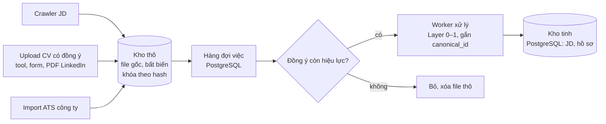

# Thu thập dữ liệu: crawler JD, nhận CV, kho thô và kho tinh – thiết kế

07/11/2026 · Leonard · Bản nháp để thảo luận

File này mô tả cách dữ liệu vào engine: JD cào từ nguồn công khai, CV có đồng ý của ứng viên, và CV công ty đưa vào. Dữ liệu được lưu ở kho thô, xử lý qua hàng đợi, rồi thành dữ liệu tinh trong PostgreSQL. Bảng hồ sơ ứng viên và cách tìm K người dùng kho tinh này, xem [ho-so-ung-vien.md](ho-so-ung-vien.md).

## 1. Ranh giới: cào JD, không cào CV

| Loại dữ liệu | Cào tự động | Lý do |
| --- | --- | --- |
| JD | Có, theo điều khoản từng trang | Tin công khai, công ty muốn nhiều người đọc. Engine cần kho JD đang mở cho luồng ứng tuyển hộ |
| CV | Không | CV trên các trang việc làm chỉ mở cho tài khoản nhà tuyển dụng trả phí, và điều khoản cấm tải hàng loạt. Đem CV đó giới thiệu cho công ty khác để thu phí rất gần với mua bán dữ liệu cá nhân. Kho cào về cũng không có `consent` và `availability` |

CV chỉ vào kho qua các nguồn có đồng ý ở mục 4. Câu hỏi pháp lý liên quan nằm ở [phap-ly.md](phap-ly.md) mục 2 và 6.

## 2. Kiến trúc: tách luồng thu thập và luồng xử lý

Luồng thu thập chỉ lấy file về và ghi vào kho thô. Luồng xử lý đọc từ hàng đợi, chạy Layer 0–1 rồi ghi kết quả vào kho tinh. Cổng đồng ý chỉ áp dụng cho CV.

Lý do tách:

- **Xử lý lại mà không phải thu lại.** Danh mục kỹ năng, prompt hoặc model đổi (`catalog_version`, `engine_version`) thì chạy lại worker trên kho thô. Trang gốc có thể đã gỡ tin.
- **Chịu lỗi tốt hơn.** AI lỗi hoặc vượt giới hạn gọi thì việc ở lại hàng đợi để thử lại; crawler không phải chạy lại.
- **Kiểm soát chi phí.** Worker chạy theo lô, giới hạn số lượt AI mỗi giờ, và bỏ bản trùng theo hash trước khi tốn token.
- **Tách quyền truy cập.** Ba lớp theo độ nhạy cảm: (1) kho thô chứa file CV còn đầy đủ thông tin cá nhân, chỉ worker được đọc; (2) `pii_vault` — schema PostgreSQL riêng (`pii.*`), tách quyền, giữ PII có cấu trúc (tên, liên hệ đã chuẩn hóa) để liên hệ và gộp, chỉ mở khi công ty bấm mời hoặc ứng viên thực hiện quyền của mình, mỗi lần mở có nhật ký ([ho-so-ung-vien.md](ho-so-ung-vien.md) mục 3.3/3.4); (3) phần đã ẩn thông tin cá nhân của kho tinh, đội vận hành và engine tìm kiếm chỉ dùng phần này và **không** đọc được `pii_vault`.
- **Có chỗ đặt cổng đồng ý.** Worker chỉ xử lý CV khi đồng ý còn hiệu lực. Ứng viên rút đồng ý thì xóa ở cả hai kho.

## 3. Crawler JD

### 3.1 Nguồn, theo thứ tự ưu tiên

| # | Nguồn | Cách lấy | Ghi chú |
| --- | --- | --- | --- |
| 1 | Trang tuyển dụng của công ty dùng ATS có API công khai | Greenhouse `boards-api.greenhouse.io/v1/boards/{công_ty}/jobs`, Lever `api.lever.co/v0/postings/{công_ty}` | JSON sạch, các API làm ra để chia sẻ tin tuyển, không cần trình duyệt. Hợp với công ty global/remote mà nhóm B nhắm tới |
| 2 | Trang việc làm IT trong nước (ITviec, TopDev) | Playwright | Đọc `robots.txt` và điều khoản từng trang trước; ưu tiên hỏi hợp tác |
| 3 | Trang việc làm tổng hợp (TopCV, VietnamWorks, CareerViet) | Playwright | Như mục 2; kiểm điều khoản trước khi lưu hàng loạt ([phap-ly.md](phap-ly.md) mục 6) |
| 4 | JD công ty hoặc người dùng tự dán | Form | Nguồn sạch nhất, dùng cho luồng công ty (V2) |
| — | LinkedIn Jobs | Không cào | Điều khoản LinkedIn cấm quét tự động. Công ty tự dán, hoặc người của mình chép tay từng JD |

**Hướng cho trang trong nước (chốt 10/11/2026):** MVP không phụ thuộc trang trong nước — adapter đầu tiên Greenhouse/Lever (API công khai, zero rủi ro) đã đủ khởi động kho JD. Với trang trong nước thì **ưu tiên hỏi hợp tác chính thức với trang IT chuyên biệt (ITviec, TopDev)** vì JD đúng nhánh hẹp đang nhắm ([chien-luoc.md](chien-luoc.md) mục 4), quy mô vừa dễ tiếp cận BD, và hợp tác tránh hẳn rủi ro điều khoản + chặn IP. Trang tổng hợp lớn (TopCV, VietnamWorks, CareerViet) để sau và **chỉ cào khi điều khoản cho phép rõ ràng**. Bước bắt buộc trước khi viết bất kỳ adapter trang trong nước nào: đọc điều khoản + `robots.txt` từng trang, lập bảng "cào được / phải hỏi / không đụng". Chưa chốt cứng trang cụ thể vì cần đọc điều khoản thực tế trước.

### 3.2 Quy tắc chạy

- Một bộ đọc (adapter) riêng cho mỗi nguồn; thêm nguồn là thêm adapter, không sửa lõi.
- Giới hạn tốc độ theo từng tên miền, ghi rõ user-agent của mình, tôn trọng `robots.txt`.
- Mỗi lần chạy ghi lại `source_url`, `fetched_at`, `content_hash`. Hash không đổi thì không đưa vào hàng đợi.
- Chạy lại định kỳ để cập nhật trạng thái "còn hiển thị". Đây là dữ liệu cho tính năng 7 (kiểm tra JD còn tuyển, [PRD.md](PRD.md) mục 4). Không kiểm tra được thì ghi "chưa rõ", không ghi "đã đóng".
- Trang đổi giao diện làm adapter hỏng thì báo lỗi và dừng adapter đó, không ghi dữ liệu rỗng vào kho.

## 4. Nhận CV có đồng ý

| Nguồn | Đầu vào | Đồng ý | Giai đoạn |
| --- | --- | --- | --- |
| Tool quét gap miễn phí | PDF/DOCX hoặc văn bản dán vào | Ô bắt buộc cho lượt quét; ô thứ hai để giữ trong kho ([ho-so-ung-vien.md](ho-so-ung-vien.md) mục 5.2) | MVP |
| PDF LinkedIn | File từ nút "Save to PDF" trên profile | Như trên | MVP |
| Form ứng tuyển hộ | CV ứng viên gửi sau khi được nhắn tin | Hai ô đồng ý | Sau khi có giấy phép dịch vụ việc làm |
| ATS hoặc kho CV của công ty | File hoặc export từ ATS | Công ty chịu trách nhiệm về đồng ý của ứng viên với họ; hồ sơ chỉ dùng cho công ty đó, không vào kho chung. **Cần DPA riêng với từng công ty** (mình là bên xử lý, công ty là bên kiểm soát), xóa khi hết hợp đồng — chốt 10/11/2026; chi tiết cần luật sư ở [phap-ly.md](phap-ly.md) mục 8 câu 11 | V2 |

Mỗi file CV vào kho thô kèm bản ghi đồng ý: nguồn, thời điểm, nội dung ô đã tick, hạn. Không có bản ghi đồng ý thì không đưa vào hàng đợi.

## 5. Lưu trữ

| Lớp | Lưu ở | Nội dung | Chính sách |
| --- | --- | --- | --- |
| Kho thô | Object storage tương thích S3 (MinIO tự host, hoặc S3 của nhà cung cấp cloud trong nước) | File gốc PDF/DOCX/HTML/JSON, khóa theo hash | CV: mã hóa, chỉ worker đọc được, xóa theo yêu cầu và khi hết hạn đồng ý (6 tháng). JD: giữ lâu |
| Kho tinh | PostgreSQL | `jd`, `jd_requirement`, `lead`, và nhóm bảng hồ sơ theo mô hình lai ở [ho-so-ung-vien.md](ho-so-ung-vien.md) mục 3.4 (`person`, `person_identifier`, `extraction`, `experience`, `skill_evidence`, `candidate_assertion`, `candidate_pref`, `consent`, `skill_summary`…), không phải một bảng `candidate_profile` đơn; thêm pgvector khi cần | Đã ẩn thông tin cá nhân; mỗi bản ghi có `engine_version`, `catalog_version`. PII gốc không nằm ở kho tinh mà ở `pii_vault` riêng (ho-so mục 3.3/3.4) |
| Hàng đợi | PostgreSQL | Bảng job: loại, khóa file thô, trạng thái, số lần thử, lỗi gần nhất | Xóa job đã xong sau một thời gian |
| Nhật ký AI | PostgreSQL | Model, phiên bản prompt, số token, thời gian của mỗi lượt gọi | Theo thời hạn Luật Trí tuệ nhân tạo yêu cầu ([phap-ly.md](phap-ly.md) mục 4) |

Đặt kho thô chứa CV ở đâu phụ thuộc vào câu đang chờ luật sư: có được đưa dữ liệu cá nhân ra nước ngoài không ([phap-ly.md](phap-ly.md) mục 2). Chưa có câu trả lời thì đặt ở máy chủ trong nước. Chỉ văn bản đã ẩn thông tin cá nhân mới được gửi sang API AI.

**Chốt 10/11/2026: dùng S3 của cloud nội địa cho MVP** (VNG Cloud, Viettel, FPT, CMC…), không tự host MinIO ở giai đoạn 0. Lý do: đội giai đoạn 0 mỏng người, một sự cố mất/lộ dữ liệu PII nguy hiểm hơn nhiều so với tiết kiệm phí hạ tầng; nhà cung cấp nội địa gánh sao lưu/bảo mật/uptime mà đội nhỏ khó làm tốt. Điều kiện bắt buộc:

- Chọn nhà cung cấp **đặt dữ liệu tại VN và cam kết hợp đồng không nhân bản ra region nước ngoài** (xác nhận bằng điều khoản, không chỉ marketing).
- Vì code dùng S3 API chuẩn nên **giữ nguyên đường lùi về MinIO tự host** không đổi code, nếu luật sư yêu cầu kiểm soát cao hơn hoặc chi phí tăng.
- Bật mã hóa at-rest và khóa truy cập chỉ worker ngay từ đầu.

## 6. Hàng đợi và worker

MVP không cần Kafka. Dùng bảng job trong PostgreSQL, worker lấy việc bằng `SELECT … FOR UPDATE SKIP LOCKED` (hoặc thư viện có sẵn như pg-boss, JobRunr), nên không thêm hệ thống mới phải vận hành.

Vòng đời một job:

1. `queued`: luồng thu thập vừa ghi file thô.
2. `running`: worker đã nhận; quá thời gian thì trả về `queued`.
3. `done`: đã ghi kho tinh.
4. `failed`: thử quá số lần cho phép (vd. 3); chờ người xem.
5. `skipped`: bản trùng theo hash, hoặc CV không còn đồng ý.

Job phải chạy lại được nhiều lần mà kết quả không đổi: ghi kho tinh theo khóa idempotency, chạy lại thì ghi đè đúng bản ghi đó. **Khóa phụ thuộc đúng những chiều phiên bản mà từng loại kết quả thực sự phụ thuộc** (chốt 10/11/2026) — `engine_version` và `catalog_version` là hai chiều độc lập, đổi vì lý do khác nhau:

- Bản trích thô (`extraction`, JSONB từ AI): khóa `content_hash` + `engine_version` + `model`. Không cần `catalog_version` vì trích thô không phụ thuộc danh mục kỹ năng.
- Kết quả gắn skill (`skill_evidence`, `skill_summary` ở [ho-so-ung-vien.md](ho-so-ung-vien.md) mục 3.4): khóa gồm thêm `catalog_version`, vì chúng phụ thuộc danh mục kỹ năng.

**Xử lý lại hàng loạt:** phân biệt theo chiều đổi — đổi `catalog_version` thì chỉ chạy lại **bước gắn skill bằng code** trên `extraction`/`experience` đã có (rẻ, không tốn lượt AI); đổi `engine_version` thì chạy lại từ file thô (có AI). Tạo job cho các bản ghi cũ theo lô và theo giới hạn chi phí. Bản ghi cũ vẫn dùng được nhưng có dấu "cũ" cho tới khi xử lý xong.

## 7. Ngôn ngữ

| Phần | Đề xuất | Lý do |
| --- | --- | --- |
| Worker xử lý Layer 0 (đọc PDF/DOCX, CV 2 cột) | Python | Thư viện đọc PDF mạnh nhất: PyMuPDF, pdfplumber, docling. Đây là phần khó nhất của Layer 0 |
| Crawler JD | Python + Playwright | Nhiều trang việc làm trong nước render bằng JS; viết chung Python với worker thì bớt một ngôn ngữ |
| API, tìm kiếm, nghiệp vụ | **Kotlin/Spring Boot** (chốt 10/11/2026) | Truy vấn SQL, tính điểm, phân quyền, thanh toán |

Hai phần nói chuyện qua hàng đợi trong PostgreSQL, không gọi trực tiếp nhau.

**Backend chính: Kotlin/Spring Boot (chốt 10/11/2026).** Lý do: nghiệp vụ SQL-centric (lọc cứng, xếp hạng theo khoảng điểm, `skill_summary` materialized, dedup) và có thanh toán B2B + dữ liệu PII nhạy cảm — hợp sở trường JVM: transaction mạnh, kiểu chặt, SQL thô qua jOOQ/JDBC trưởng thành, tính điểm hàng loạt (2K người/yêu cầu) chạy tốt trên JVM. Khớp stack backend của team để review và bảo trì lâu dài. Python vẫn giữ nguyên cho worker Layer 0 và crawler như bảng trên; kiến trúc hai ngôn ngữ nói chuyện qua hàng đợi vẫn đúng.

## 8. Bộ chỉ số

Các ngưỡng là đề xuất, cần team chốt.

| Chỉ số | Ngưỡng đề xuất |
| --- | --- |
| Rò rỉ thông tin cá nhân từ kho thô sang kho tinh hoặc sang API AI | 0 |
| CV được xử lý khi không có bản ghi đồng ý còn hạn | 0 |
| Yêu cầu xóa dữ liệu được xóa ở cả hai kho | 100%, trong thời hạn chính sách quyền riêng tư cam kết |
| Job `failed` trên tổng số job | ≤ 2% |
| Thời gian từ lúc nhận CV tới khi có hồ sơ (p95) | < 60 giây |
| Adapter JD hỏng được phát hiện | Trong lần chạy kế tiếp |

## 9. Thứ tự làm

1. **Bảng job và kho thô**, kèm bản ghi đồng ý cho CV.
2. **Worker Layer 0–1 bằng Python** ghi vào kho tinh; dùng lại prompt của bản demo.
3. **Nhận CV từ tool miễn phí và PDF LinkedIn.**
4. **Adapter JD đầu tiên:** Greenhouse và Lever (JSON, ít rủi ro nhất).
5. **Xóa dữ liệu theo yêu cầu** ở cả hai kho.
6. **Adapter cho trang việc làm trong nước**, sau khi kiểm điều khoản từng trang.

## 10. Câu hỏi cần bàn

Tick khi đã chốt và ghi câu trả lời ngay dưới.

- [x] Kho thô đặt ở đâu: MinIO tự host hay S3 của nhà cung cấp cloud trong nước? Chốt 10/11/2026: S3 cloud nội địa cho MVP (đặt tại VN, cam kết hợp đồng không nhân bản ra nước ngoài), giữ đường lùi về MinIO vì code dùng S3 API chuẩn. Chi tiết ở mục 5.
- [x] Giữ file CV gốc bao lâu sau khi đã có hồ sơ: tới khi hết hạn đồng ý, hay xóa sớm hơn và chỉ giữ văn bản đã ẩn thông tin cá nhân? Chốt 10/11/2026: giữ file gốc PDF/DOCX tới khi hết hạn đồng ý 6 tháng (một mốc xóa thống nhất với `searchable_expires`, khớp [ho-so-ung-vien.md](ho-so-ung-vien.md) mục 3.2), vì cần cho rerun khâu đọc PDF Layer 0 và xuất trình CV gốc khi công ty hỏi ([chien-luoc.md](chien-luoc.md) mục 2). Đường lùi nếu luật sư siết: xóa file gốc sớm (vd. 30 ngày), chỉ giữ text đã ẩn PII (`experience_lines` + `extraction`) cho rerun Layer 1–3, chấp nhận mất khả năng rerun Layer 0. PII gốc luôn ở `pii_vault` tách riêng.
- [x] Trang việc làm trong nước nào hỏi hợp tác trước thay vì cào? Chốt 10/11/2026: ưu tiên hỏi hợp tác ITviec/TopDev (JD đúng nhánh hẹp, quy mô vừa); trang tổng hợp (TopCV/VNW/CareerViet) chỉ cào nếu điều khoản cho phép; bắt buộc đọc điều khoản + robots.txt từng trang trước khi viết adapter. Chưa chốt cứng trang cụ thể. Chi tiết ở mục 3.1.
- [x] Backend chính viết bằng Kotlin/Spring Boot hay TypeScript? Chốt 10/11/2026: Kotlin/Spring Boot — nghiệp vụ SQL-centric + thanh toán + PII hợp JVM (transaction mạnh, kiểu chặt, jOOQ/JDBC, tính điểm hàng loạt). Python giữ nguyên cho worker/crawler. Chi tiết ở mục 7.
- [x] CV từ ATS của công ty: có cần hợp đồng xử lý dữ liệu riêng với từng công ty không? (bổ sung vào [phap-ly.md](phap-ly.md) mục 8) Chốt 10/11/2026: có, cần DPA riêng — mình là bên xử lý, công ty là bên kiểm soát, CV không trộn kho chung, xóa khi hết hợp đồng. Ba điểm cần luật sư xác nhận đã chuyển sang phap-ly mục 8 câu 11. Là luồng V2, không chặn MVP.

## Nguồn

- [ho-so-ung-vien.md](ho-so-ung-vien.md), mục 3, 5, 6
- [engine.md](engine.md), mục 2, 4
- [PRD.md](PRD.md), mục 4 (tính năng 7, 14), mục 5
- [phap-ly.md](phap-ly.md), mục 2, 4, 6, 8
